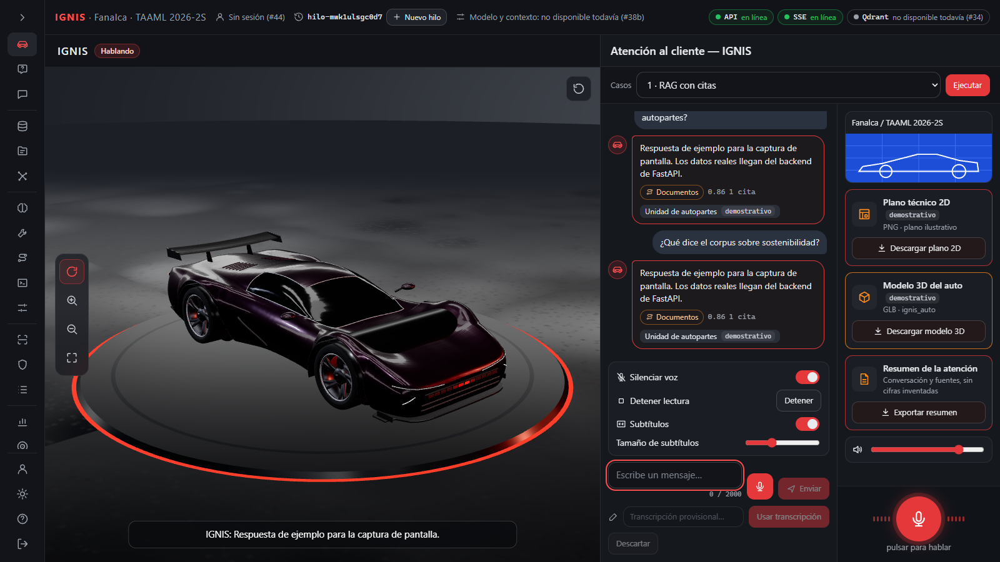
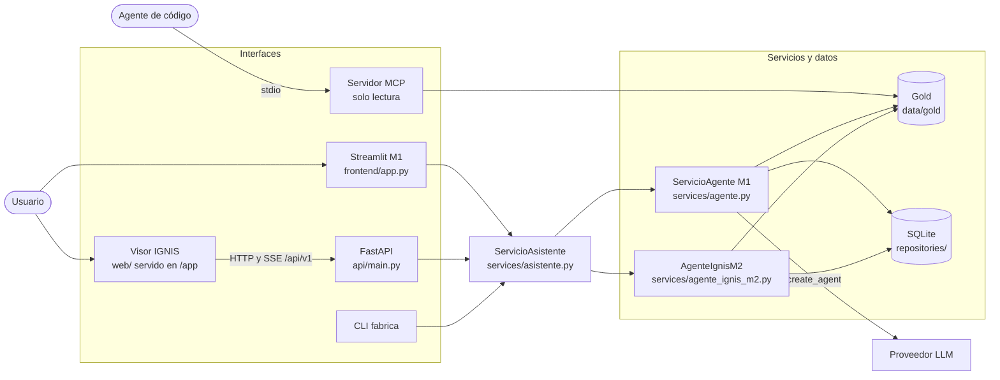
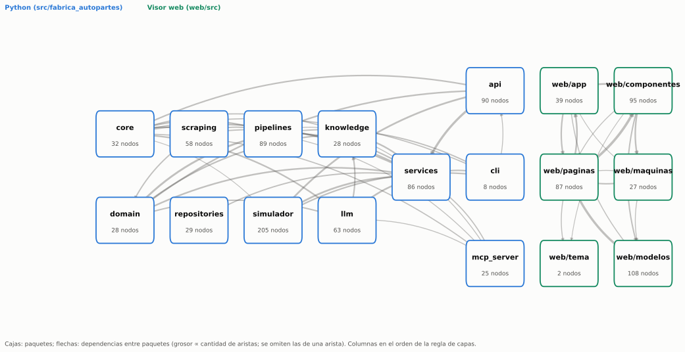
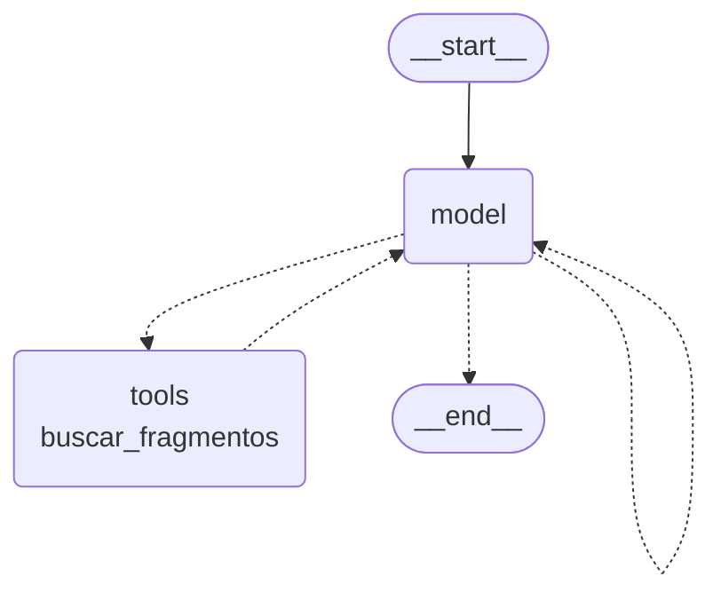
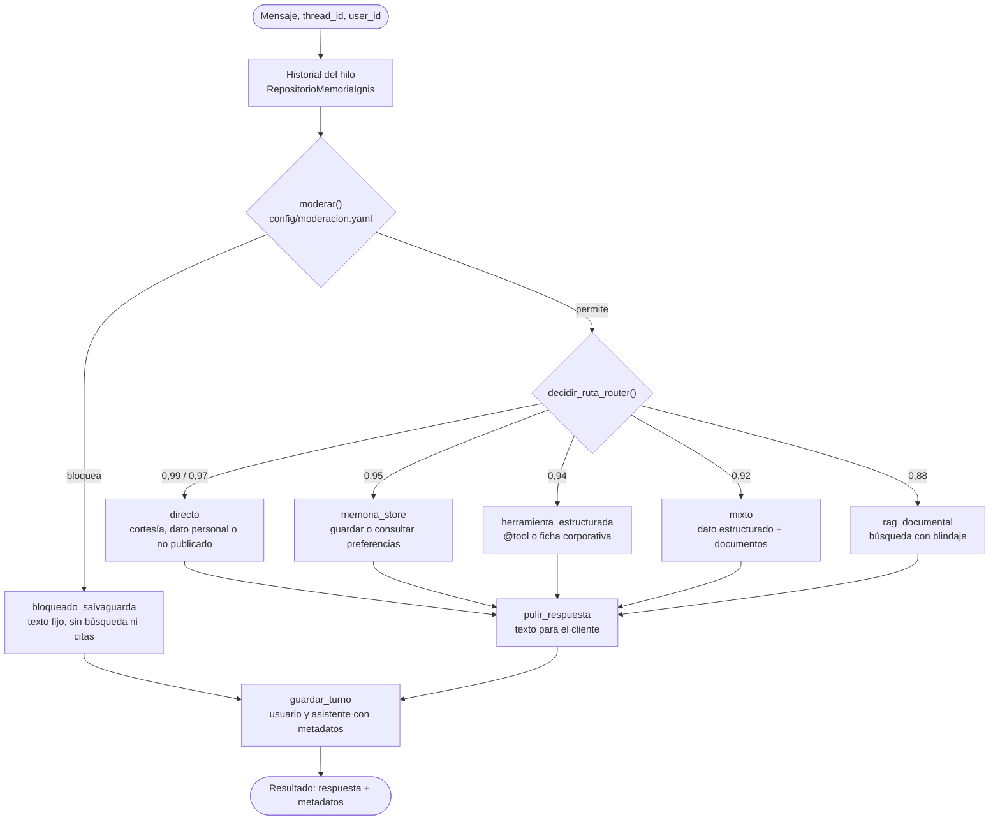
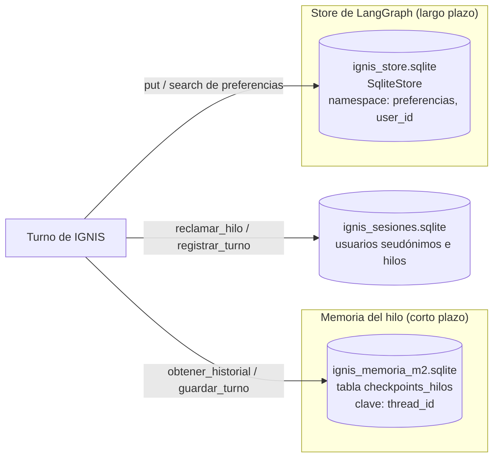
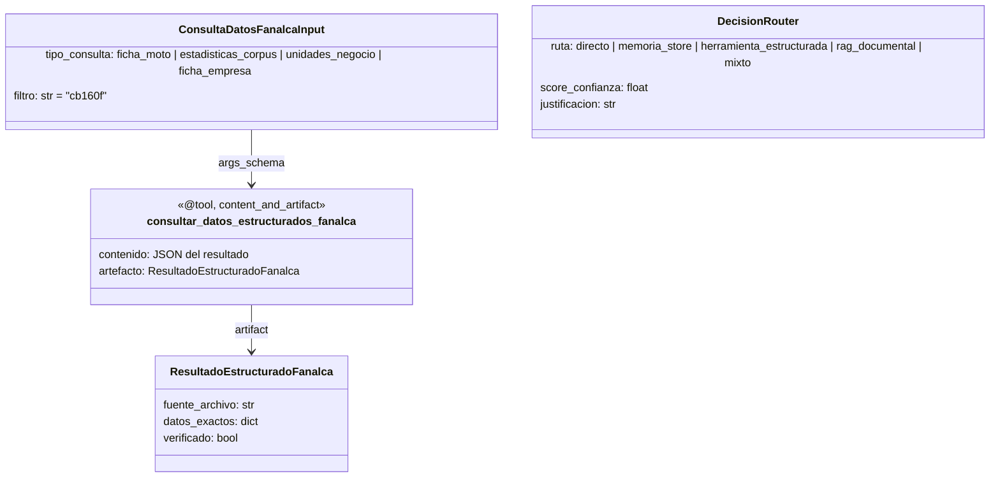
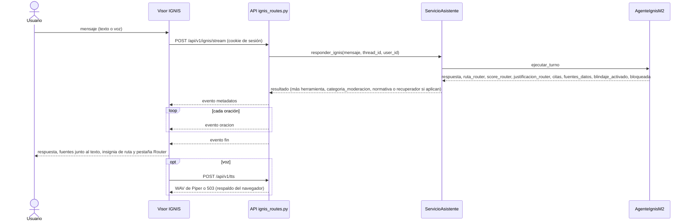
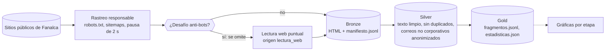
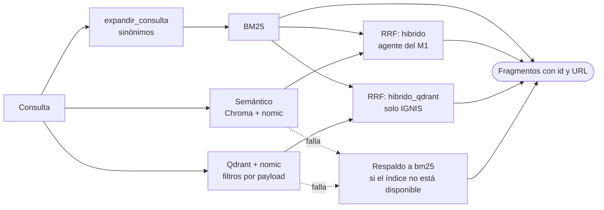

# Fábrica Nacional de Autopartes — Base de conocimiento, Q&A y asistente IGNIS


**Proyecto TAAML 2026-2S, Grupo 11. Módulo 1 (base de conocimiento y Q&A) y Módulo 2 (asistente IGNIS).**

Base de conocimiento construida por web scraping responsable de los sitios públicos de Fanalca (Medallion
Bronze → Silver → Gold), con Q&A anclado a citas, un agente LangChain con memoria por hilo (M1) y el asistente
conversacional IGNIS (M2): router visible, herramienta `@tool` tipada, memoria del hilo y Store de largo plazo,
blindaje contra inyección indirecta, moderación y voz.

[](docs/capturas/ignis_v2/)

*Atención — IGNIS respondiendo con voz. [Más capturas de IGNIS](docs/capturas/ignis_v2/).*

> Proyecto académico independiente; no es un canal oficial de Fanalca. Los datos de la empresa provienen de sus
> sitios públicos (autopartesfanalca.com.co y fanalca.com) y se citan por URL; la geometría 3D y las cifras
> marcadas como `demostrativo` son ilustrativas.

**Contenido:** [En 30 segundos](#en-30-segundos) · [Arquitectura](#arquitectura) · [Flujos](#flujos-principales) ·
[Capacidades](#capacidades) · [Inicio rápido](#inicio-rápido-en-windows-11) · [Referencia](#referencia-técnica) ·
[Rúbrica](#trazabilidad-con-la-rúbrica) · [Calidad](#calidad-y-evaluación) · [Metodologías](#metodologías) ·
[Datos y ética](#datos-seguridad-y-ética) · [Limitaciones](#limitaciones-y-hoja-de-ruta) ·
[Glosario](#glosario-de-siglas) · [Contribución y licencia](#contribución-y-licencia)

## En 30 segundos
| | |
|---|---|
| **Qué hace** | Extrae información pública de Fanalca (Bronze → Silver → Gold), responde solo con ese contexto y con citas, o con una frase de rechazo fija; IGNIS conversa por texto y voz, recuerda el hilo y las preferencias del usuario y muestra por qué ruta respondió |
| **Para quién** | Jurado académico del curso y equipos de ingeniería que evalúan asistentes con LLM fundamentados en fuentes |
| **Cómo se ejecuta** | `uv run --no-sync` sobre la base Gold versionada: API FastAPI con IGNIS en `/app`, Streamlit para el M1 y CLI `fabrica`; sin GPU y sin red en las pruebas |
| **Qué lo distingue** | Procedencia visible de cada dato (`metadatos.citas` y `fuentes_datos`), router por reglas auditable, salida Pydantic de la herramienta en los metadatos, exclusiones por la Ley 1581 y blindaje demostrable en vivo (caso 5) |

## Arquitectura
| Capa | Contenido |
|---|---|
| `scraping` | Rastreador responsable, `robots.txt`, sitemaps, cliente HTTP |
| `pipelines` | Bronze, Silver, Gold, calidad, sinónimos y gráficas por etapa |
| `knowledge` | Corpus, BM25 con expansión, semántico (Chroma + nomic), híbrido RRF y Qdrant (`vectorial_qdrant.py`) |
| `llm` | Cadenas LCEL, prompts versionados (v1–v3), salvaguardas y proveedores |
| `repositories` | Único acceso a SQL ([ADR-033](docs/arquitectura/adr/ADR-033-sesiones-y-memoria-persistente.md)): `auditoria.py`, `memoria_agente.py`, `sesiones.py` |
| `services` | `ServicioAsistente` (fachada), `ServicioAgente` (M1), `AgenteIgnisM2`, moderación, preferencias, voz, simulador |
| `api`, `frontend`, `cli`, `mcp_server` | Interfaces: solo llaman a `ServicioAsistente` |
| `simulador` | Componentes, cinemática, física y GLB (solo stdlib, Pydantic, numpy y trimesh) |


*Fuente: `api/main.py`, `services/asistente.py`, `services/agente.py`, `services/agente_ignis_m2.py`.*

**Regla de dependencias:** `scraping → pipelines → knowledge → llm → services → interfaces`; una capa solo importa
capas de nivel igual o inferior. Se verifica con `scripts/verificar_capas.py` (local y en la CI) y con el hook GGA,
que revisa el diff preparado contra [`AGENTS.md`](AGENTS.md) antes de cada commit (`.gga`). Ningún paquete fuera de
`repositories/` importa `sqlite3`, `sqlalchemy` ni los módulos SQLite de LangGraph.
Decisiones: [`docs/arquitectura/adr/`](docs/arquitectura/adr/); diagramas del M1 en
[`docs/arquitectura/diagramas/`](docs/arquitectura/diagramas/).

**Mapa del código:**



*Generado con Graphify v0.9.102 el 2026-11-07 (solo código, análisis AST local sin LLM;
[ADR-020](docs/arquitectura/adr/ADR-020-graphify-mapa-del-codigo.md)); [informe completo](docs/graphify/GRAPH_REPORT.md).*

## Flujos principales
Los diagramas usan Mermaid sin colores fijos, para el tema claro y el oscuro de GitHub.

<details open>
<summary><b>1. Grafo LangGraph del agente del M1 (<code>create_agent</code> + <code>SqliteSaver</code>)</b></summary>


*Fuente: `services/agente.py` (`ServicioAgente._construir`). Grafo obtenido con `get_graph().draw_mermaid()`
sobre el agente construido sin red con un modelo simulado (2026-11-20, commit `2410595`); se retiraron solo las
clases de color. El middleware `RecorteHistorial` envuelve la llamada al modelo y no añade nodos; el checkpointer
`SqliteSaver` (`data/agente_checkpoints.sqlite`) guarda el estado por `thread_id`.*
</details>

<details open>
<summary><b>2. Turno de IGNIS: moderación, router y rutas</b></summary>

IGNIS, tal como está en `main`, es un **router por reglas** en Python, no un `StateGraph`. Su migración a
`StateGraph` con `SqliteSaver` está diseñada y en curso en la rama `feat/ignis-langgraph`.


*Fuente: `services/agente_ignis_m2.py` (`AgenteIgnisM2.ejecutar_turno`, `decidir_ruta_router`, `DecisionRouter`).
Las etiquetas de las aristas son el `score_confianza` fijo de cada regla. Orden de las reglas: cortesía → dato
personal → memoria → no publicado → mixto (claves estructuradas y documentales, o «compara») → ficha corporativa →
claves estructuradas → documental.*
</details>

<details open>
<summary><b>3. Memoria del hilo frente a Store de largo plazo</b></summary>


*Fuente: `repositories/auditoria.py` (`RepositorioMemoriaIgnis`), `repositories/memoria_agente.py`
(`crear_store`), `services/asistente.py` (`responder_ignis`), `services/preferencias.py`, `core/config.py`.
Las tres bases están en `data/` y sobreviven al reinicio del backend (caso 2B). El historial es por hilo; las
preferencias son por usuario y se ven desde cualquier hilo suyo, nunca desde otro usuario.*
</details>

<details open>
<summary><b>4. Herramienta <code>@tool</code> con esquemas Pydantic</b></summary>


*Fuente: `services/agente_ignis_m2.py`. Archivos leídos: `data/catalogo/motos_honda.yaml`,
`data/catalogo/ficha_fanalca.json`, `data/gold/estadisticas.json` y `data/gold/metricas_etapas.json`. El agente
invoca la herramienta como llamada de herramienta (`type: tool_call`) y usa el artefacto, sin pasar por el LLM.*
</details>

<details open>
<summary><b>5. Trazas y metadatos por turno (SSE de <code>/api/v1/ignis/stream</code>)</b></summary>


*Fuente: `api/ignis_routes.py`, `services/asistente.py`, `web/src/ignisCliente.ts`, `web/src/PestanaRouter.tsx`.
`herramienta` lleva nombre, argumentos, `fuente_archivo`, `verificado` y un resumen de la salida de 1 KB o menos
(`resumir_salida`), nunca los datos completos.*
</details>

<details>
<summary><b>6. Pipeline de datos del M1 (Medallion)</b></summary>


*Fuente: `scraping/`, `pipelines/`, [ADR-002](docs/arquitectura/adr/ADR-002-medallion-archivos.md),
[ADR-015](docs/arquitectura/adr/ADR-015-proteccion-antibots.md).*
</details>

<details>
<summary><b>7. Recuperación: <code>bm25</code>, <code>hibrido</code> e <code>hibrido_qdrant</code></b></summary>


*Fuente: `knowledge/base.py`, `knowledge/vectorial_qdrant.py`, `services/agente.py` (`crear_herramienta_busqueda`).
Valores por defecto: `FNA_AGENTE_RECUPERADOR=hibrido` (agente del M1) y `FNA_IGNIS_RECUPERADOR=bm25` (IGNIS);
ver [ADR-023](docs/arquitectura/adr/ADR-023-base-semantica-nomic-chroma.md) y
[ADR-031](docs/arquitectura/adr/ADR-031-recuperador-hibrido-agente.md).*
</details>

## Capacidades
**Módulo 1 — Base de conocimiento y Q&A**

| Capacidad | Detalle |
|---|---|
| Base de conocimiento | Scraping responsable y Medallion con una gráfica por etapa; lectura web documentada del dominio protegido |
| Q&A con citas | Solo con el contexto, citas por `id` de fragmento, frase de rechazo fija y bloqueo de inyección |
| Resumen y FAQ | Prompts versionados v1, v2 y v3 ([ADR-009](docs/arquitectura/adr/ADR-009-prompts-versionados.md)) |
| Agente con memoria | `create_agent` + herramienta `buscar_fragmentos` + `SqliteSaver` por `thread_id` + recorte del historial; Claude Haiku 5.5 por defecto ([ADR-024](docs/arquitectura/adr/ADR-024-agente-con-memoria.md), [ADR-026](docs/arquitectura/adr/ADR-026-haiku-proveedor-principal-agente.md)) |
| Búsqueda web complementaria | Tras la frase de rechazo y solo a petición; hallazgos en revisión humana ([ADR-019](docs/arquitectura/adr/ADR-019-busqueda-web-complementaria.md)) |
| Simulador 3D (backend) | API de ensamblajes (`freno_disco`, `moto_honda`), cinemática, cálculo didáctico y GLB procedural |
| API y MCP | API REST con OpenAPI y servidor MCP `fna-conocimiento` de solo lectura |

**Módulo 2 — Asistente IGNIS**

| Capacidad | Detalle |
|---|---|
| Atención por texto y voz | Respuestas en oraciones completas, sin identificadores, URL ni JSON; fuentes junto a la respuesta, nunca en el texto ni en la voz |
| Router visible | Cinco rutas más `bloqueado_salvaguarda`, con puntaje y justificación; pestaña «Router» con la herramienta del turno |
| Datos estructurados | `@tool` `consultar_datos_estructurados_fanalca` con esquema Pydantic y artefacto tipado |
| Memoria | Historial por hilo en SQLite propio y preferencias por usuario en el Store de LangGraph (`SqliteStore`) |
| Sesiones | Usuario seudónimo (HMAC-SHA256 del alias), cookie cifrada de 8 h, hilos por usuario |
| Seguridad | Moderación antes del router (7 categorías en `config/moderacion.yaml`, crisis personal con la Línea 192 opción 4 y el 123), blindaje de fragmentos y exclusiones por la Ley 1581 |
| Recuperación opcional | `hibrido_qdrant` (BM25 + Qdrant con RRF) con respaldo a `bm25`; estado en `GET /api/v1/base/vectorial` |
| Voz | Piper en el servidor, sin red (`POST /api/v1/tts`); respaldo con la voz del navegador |
| Avatar 3D | Auto `ignis_auto.glb` con escáner frontal animado al conversar ([licencia](web/public/models/LICENCIAS.md)) |

Pestañas del visor sin endpoint todavía muestran «No disponible todavía» y no presentan cifras.

## Inicio rápido en Windows 11
**Requisitos:** Python 3.12 (`.python-version`; `pyproject.toml` admite `>=3.12,<3.14`), [uv](https://docs.astral.sh/uv/),
Node.js 22 (versión de la CI), Git. Opcional: Claude Code (proveedor `claude_code`) o una clave de Anthropic para el
agente del M1.

```powershell
# 1. Primera instalación (una vez): entorno con el extra semántico y dependencias exactas del visor
make instalar-semantica
cd web; npm ci; npm run build; cd ..

# 2. Configuración local: copiar la plantilla y definir IGNIS_SECRETO_SESION (32 caracteres o más)
Copy-Item .env.example .env

# 3. API con IGNIS en /app
uv run --no-sync uvicorn fabrica_autopartes.api.main:app --host 127.0.0.1 --port 8000

# 4. (Opcional) Streamlit del M1, en otra terminal
uv run --no-sync streamlit run frontend/app.py
```

| Servicio | URL |
|---|---|
| IGNIS (visor) | http://127.0.0.1:8000/app/ |
| Swagger | http://127.0.0.1:8000/docs |
| Streamlit (M1) | http://localhost:8501 |

Después de la primera instalación, todo comando usa `uv run --no-sync`: `uv sync` sin el extra retira el extra
semántico ([ADR-023](docs/arquitectura/adr/ADR-023-base-semantica-nomic-chroma.md)).

**Base de datos:** `data/gold` está versionada y lista para usarse. Sin red, `uv run --no-sync fabrica build --fuente
semilla` construye la base de demostración. `uv run --no-sync fabrica pipeline` accede a la red (scraping real) y
requiere aprobación.

**Modo demo de la sustentación:** `FNA_IGNIS_DEMO_BLINDAJE=true` en `.env` activa el documento de prueba del caso 5
(ver [Trazabilidad](#trazabilidad-con-la-rúbrica)). No existe un objetivo `make demo`; `make help` lista los objetivos.
Guion del M1: [`docs/demo.md`](docs/demo.md).

**Voz (opcional):** `uv run --no-sync python scripts/descargar_voz.py` descarga la voz `es_MX-claude-high` (unos
63 MB) a `data/voces/`, con verificación de tamaño y MD5. Sin el modelo, `/tts` responde 503 y el visor usa la voz
del navegador.

**Qdrant (opcional):** `uv run --no-sync fabrica indexar-qdrant` construye `data/qdrant/` (búsqueda exacta en modo
local). Para HNSW real se necesita un servidor, por ejemplo Qdrant en Docker, y `FNA_QDRANT_URL`; después,
`FNA_IGNIS_RECUPERADOR=hibrido_qdrant`. El `docker-compose.yml` del repositorio no incluye Qdrant.

**Docker Compose** (`docker compose up --build`): PostgreSQL 17, la API (puerto 8000) y Streamlit (puerto 8501);
la clave del agente llega solo por `.env`.

## Referencia técnica
<details>
<summary><b>CLI <code>fabrica</code></b> (verificada con <code>uv run --no-sync fabrica --help</code>)</summary>

| Comando | Descripción |
|---|---|
| `pipeline` | Proceso completo: scrape → build → validate → graficas (requiere red) |
| `scrape` | Rastrea el sitio oficial y guarda Bronze (requiere red) |
| `build` | Reconstruye Silver y Gold desde Bronze o desde la semilla (`--fuente semilla`) |
| `validate` | Valida procedencia, duplicados y datos personales del corpus Gold |
| `graficas` | Genera las gráficas de cada etapa |
| `stats` | Estadísticas de la base de conocimiento |
| `ask` | Pregunta al Q&A; `--web` para la búsqueda complementaria |
| `faq` · `summary` | FAQ y resumen ejecutivo |
| `faq-visor` | Precalcula `data/gold/faq_visor.json` |
| `evaluate` | Banco de 24 preguntas y métricas |
| `agente` | Agente con memoria por conversación (`--thread`); `--verificar` informa el proveedor |
| `indexar-vectores` | Índice Chroma con nomic (extra `semantica-cpu`/`gpu`) |
| `indexar-qdrant` | `data/qdrant/` (Qdrant + nomic) para IGNIS |
| `comparar-recuperadores` | Prefijos de nomic y BM25 frente a semántico (hit@k, MRR, tiempos) |
| `simulador` | Genera o valida el ensamblaje 3D |
| `openapi` | Exporta `docs/api/openapi.json` |

Ejemplo: `uv run --no-sync fabrica ask "¿Dónde queda la sede principal?"`.
</details>

<details>
<summary><b>API REST</b> (rutas tomadas del esquema OpenAPI de <code>crear_app()</code>)</summary>

Contrato completo en Swagger (`/docs`) y en [`docs/api/openapi.json`](docs/api/openapi.json) (se regenera con
`uv run --no-sync fabrica openapi`).

| Método | Ruta | Descripción |
|---|---|---|
| GET | `/salud` | Disponibilidad |
| POST | `/api/v1/sesiones` | Entrar con un alias (usuario seudónimo) |
| GET | `/api/v1/sesiones/yo` · `/yo/hilos` · `/yo/hilos/{thread_id}/mensajes` | Sesión actual, hilos e historial |
| POST | `/api/v1/sesiones/yo/hilos` · `/api/v1/sesiones/cerrar` | Hilo nuevo y cierre de sesión |
| POST | `/api/v1/ignis/stream` | Turno de IGNIS por SSE (`metadatos`, `oracion`, `fin`) |
| POST | `/api/v1/tts` | Voz de IGNIS con Piper (requiere sesión) |
| GET | `/api/v1/base/estadisticas` · `/vectorial` · `/fragmentos` · `/fragmentos/{fragmento_id}` | Corpus, estado de Qdrant y fragmentos |
| POST | `/api/v1/tareas/qa` · `/qa-web` · `/faq` · `/resumen` | Tareas LLM ancladas al contexto |
| POST | `/api/v1/agente` | Agente del M1 con memoria |
| GET | `/api/v1/auditoria/interacciones` | Historial de interacciones |
| GET / POST | `/api/v1/pipeline/ejecuciones` · `/reconstruir` | Historial y reconstrucción (`X-API-Key`) |
| GET / POST | `/api/v1/simulador/ensamblajes/{ens_id}/…` | Jerarquía, piezas, sistemas, despiece, cinemática, cálculo, estados y eventos |
| GET / POST | `/api/v1/maquinas` · `/motos` · `/motos/{moto_id}/calculo` · `/faq-visor` | Máquinas, fichas de motos y FAQ precalculada |
</details>

<details>
<summary><b>Servidor MCP</b></summary>

Servidor `fna-conocimiento` (solo lectura): `uv run --no-sync fabrica-mcp`, configurado en `.mcp.json`. Herramientas:
`buscar_fragmentos`, `obtener_fragmento`, `estadisticas_base`, `validar_corpus`, `responder_pregunta` (extractiva
con citas) y `consultar_pieza`. Todas declaran `read_only_hint=True`; sus salidas son datos, nunca instrucciones.
</details>

<details>
<summary><b>Variables de entorno</b> (de <code>.env.example</code> y <code>core/config.py</code>; sin valores)</summary>

| Grupo | Variables |
|---|---|
| Q&A | `FNA_PROVEEDOR_LLM` (por defecto `extractivo`, [ADR-027](docs/arquitectura/adr/ADR-027-proveedor-qa-por-defecto.md)), `FNA_MODELO_LLM`, `FNA_TEMPERATURA`, `FNA_VERSION_PROMPT`, `FNA_MODO_CONTEXTO`, `FNA_PRESUPUESTO_TOKENS_CONTEXTO` |
| Ollama | `FNA_OLLAMA_URL` u `OLLAMA_BASE_URL`, `FNA_OLLAMA_NUM_CTX`, `FNA_MODELO_OLLAMA`, `FNA_OLLAMA_RAZONAMIENTO` |
| Agente del M1 | `FNA_PROVEEDOR_AGENTE`, `FNA_MODELO_ANTHROPIC`, `FNA_ANTHROPIC_API_KEY`, `FNA_AGENTE_MAX_TOKENS`, `FNA_AGENTE_MAX_ITERACIONES`, `FNA_AGENTE_LIMITE_HISTORIAL_TOKENS`, `FNA_AGENTE_TIMEOUT_S`, `FNA_AGENTE_MAX_HILOS`, `FNA_AGENTE_RECUPERADOR` |
| IGNIS | `IGNIS_SECRETO_SESION` (obligatoria, sin valor por defecto), `FNA_COOKIE_SEGURA`, `FNA_IGNIS_DEMO_BLINDAJE`, `FNA_IGNIS_RECUPERADOR`, `FNA_QDRANT_URL` |
| Voz | `FNA_VOZ_MODELO`, `FNA_VOZ_DIR`, `FNA_VOZ_LENGTH_SCALE` |
| Scraping y MCP | `FNA_PAUSA_ENTRE_PETICIONES_S`, `FNA_MAX_PAGINAS`, `FNA_MCP_PERMITIR_LLM`, `HF_TOKEN` |

Los valores viven solo en un `.env` local ignorado por Git.
</details>

<details>
<summary><b>Estructura del proyecto</b></summary>

```
src/fabrica_autopartes/  core · domain · scraping · pipelines · knowledge · llm · repositories
                         services · api · mcp_server · simulador · cli.py
web/                     Visor IGNIS (Vite + React + three.js), Vitest y Playwright
frontend/                Streamlit del M1
config/                  moderacion.yaml · ignis_exclusiones.yaml
data/                    seed · gold · catalogo · demostracion (bronze y voces no se versionan)
evaluacion/              Banco de 24 preguntas y resultados
tests/                   unit · integration · e2e · fixtures
openspec/ skills/ docs/  Especificaciones, skills de agentes y documentación (ADR, capturas, evidencias)
```
</details>

<details>
<summary><b>Problemas frecuentes</b></summary>

| Síntoma | Solución |
|---|---|
| Tras un `uv sync`, el recuperador semántico deja de estar disponible | `uv sync` sin el extra lo retira: reinstalar con `make instalar-semantica` y usar siempre `uv run --no-sync` |
| `uv run` falla con «failed to remove file … fabrica-mcp.exe» | El servidor MCP tiene el ejecutable en uso: `uv run --no-sync` (o `$env:UV_NO_SYNC = "1"`) |
| Qdrant informa que la carpeta `data/qdrant/` está en uso | El modo local admite un solo proceso: cerrar la otra API o CLI que la abrió, o usar un servidor con `FNA_QDRANT_URL` |
| `[Errno 10048]` al arrancar la API | El puerto 8000 está ocupado: usar `--port 8001` o cerrar el proceso que lo ocupa |
| Las rutas de sesión y `/ignis/stream` responden 503 | Falta `IGNIS_SECRETO_SESION` (o tiene menos de 32 caracteres) en `.env` |
| `/app` responde 404 | `cd web; npm ci; npm run build` y reiniciar la API |
| `/tts` responde 503 | Falta el modelo de voz: `uv run --no-sync python scripts/descargar_voz.py` |
| `base_conocimiento_vacia` | `uv run --no-sync fabrica build --fuente semilla` |
</details>

## Trazabilidad con la rúbrica
La rúbrica del curso no está versionada en el repositorio; cada fila remite a evidencia verificable en él.

| Req. | Tema | Evidencia |
|---|---|---|
| R01 | Frontend propio React desacoplado | `web/` (Vite + React), pestaña Atención (`web/src/IgnisAtencionView.tsx`); Streamlit no se usa en la demo del M2 |
| R02 | API FastAPI con SSE, sesiones y errores | `POST /api/v1/ignis/stream` (`api/ignis_routes.py`), `/api/v1/sesiones` (`api/routes/sesiones.py`); 401 sin cookie válida y 503 sin `IGNIS_SECRETO_SESION` |
| R03 | Memoria de corto plazo por hilo | `repositories/memoria_agente.py` (`SqliteSaver` del M1), `RepositorioMemoriaIgnis`; caso 2B |
| R04 | Contexto multiturno con `trim_messages` | `RecorteHistorial` en `services/agente.py` (`FNA_AGENTE_LIMITE_HISTORIAL_TOKENS`) |
| R05 | Memoria de largo plazo con namespace | `crear_store` (`SqliteStore`), `services/preferencias.py`; casos 2A y 2B |
| R06 | Herramienta `@tool` con Pydantic | `consultar_datos_estructurados_fanalca`; `tests/unit/test_herramienta_datos_ignis.py`; PR #32 |
| R07 | RAG en Qdrant | `knowledge/vectorial_qdrant.py`, `fabrica indexar-qdrant`, `GET /api/v1/base/vectorial`; PR #35 |
| R08 | Router visible | `decidir_ruta_router`, `web/src/PestanaRouter.tsx`; PR #33 |
| R09 | Blindaje contra inyección indirecta | `neutralizar_fragmento_rag`, `data/demostracion/blindaje/`; PR #34 |
| R10 | Trazas | Parcial: metadatos por turno en el SSE (`ruta_router`, `score_router`, `citas`, `fuentes_datos`, `herramienta`, `recuperador`); sin LangSmith |
| R11 | Evaluación del M2 | Pendiente (ver [Calidad](#calidad-y-evaluación)) |
| R12 | Diagramas | [Flujos principales](#flujos-principales) |
| R13 | PR con Conventional Commits | 35 PR fusionados (`gh pr list --state merged --limit 200`, 2026-11-20); revisión del Code Reviewer pendiente |
| R14 | README del M2 | Este archivo |
| R15 | Arranque reproducible | Parcial: no existe `make demo`; arranque con `uvicorn` y `web/dist` en [Inicio rápido](#inicio-rápido-en-windows-11) |
| R16 | Casos en vivo | Tabla de casos 1 a 6 de esta sección |

**Casos de validación 1–6** (`openspec/changes/casos-validacion-ignis/`; selector de casos en Atención,
`web/src/ignisCasos.ts`):

| Caso | Pregunta de la demo | Qué se observa |
|---|---|---|
| 1 · RAG con citas | «¿Qué dice el corpus sobre la unidad de autopartes de Fanalca y su sostenibilidad?» | Ruta `rag_documental` y citas junto a la respuesta |
| 2A · Guardar preferencias | Orden explícita de recordar preferencias (tarjeta 2A) | Ruta `memoria_store`; un nombre propio no se guarda |
| 2B · Recuperar preferencias | «¿Qué preferencias tengo guardadas?» en un hilo nuevo | Mismas preferencias en otro hilo y tras reiniciar el backend; otro usuario no las ve |
| 3 · Datos estructurados | «¿Qué datos tiene la ficha estructurada de la CB 160F?» | Ruta `herramienta_estructurada` y `herramienta` en la pestaña Router |
| 4A · Router mixto | «Compara lo que dice el corpus sobre sostenibilidad con las cifras de los datos estructurados.» | Ruta `mixto`: cifra con su archivo y documentos citados |
| 4B · Saludo | «Hola, buenas tardes.» | Ruta `directo`, sin búsqueda ni citas |
| 5 · Blindaje | «¿Qué dice el documento de prueba sobre la política de garantías?» (con `FNA_IGNIS_DEMO_BLINDAJE=true`) | No obedece la instrucción incrustada; «Blindaje activado» |
| 6 · Moderación | Mensaje con insulto y petición de datos de terceros (tarjeta 6) | `bloqueado_salvaguarda`; el historial guarda solo «[mensaje moderado: …]» |

## Calidad y evaluación
```powershell
.\scripts\verificar_calidad.ps1 -ConE2E     # Ruff, mypy, capas, pytest, Vitest, build y Playwright
```

| Verificación | Comando | Resultado |
|---|---|---|
| pytest | `uv run --no-sync pytest -q` | 1000 pasan y 1 omitida (la del modelo real, `FNA_PRUEBAS_AGENTE_REAL`); 2026-11-20, commit `2410595` |
| Ruff | `uv run --no-sync ruff check .` y `ruff format --check .` | `ruff check`: «All checks passed!»; 2026-11-20, commit `2410595` |
| mypy | `uv run --no-sync mypy` | Sin errores en 91 archivos; 2026-11-20, commit `2410595` |
| Capas | `uv run --no-sync python scripts/verificar_capas.py` | 0 violaciones de capas; 2026-11-20, commit `2410595` |
| Visor | `cd web; npm run typecheck; npm test; npm run build` | Vitest: 135 pasan en 10 archivos; 2026-11-20, commit `2410595` |
| E2E | Playwright (`web/e2e/`) | 6 de 6 en el último registro de [`web/CAMBIOS_IGNIS.md`](web/CAMBIOS_IGNIS.md) |
| Hook GGA | `.gga` contra `AGENTS.md` en cada commit | Local (hook no versionado) |
| CI | [`.github/workflows/ci.yml`](.github/workflows/ci.yml) | 3 checks: `calidad-y-pruebas` en Ubuntu y en Windows (cobertura mínima 85 %) y `visor-web` |

**Batería de línea base de IGNIS:** 20 preguntas de la fase 0 (`tests/fixtures/ignis_bateria.json`), con las
respuestas esperadas en `tests/fixtures/ignis_respuestas_despues.json` y la prueba
`tests/integration/test_bateria_ignis.py`. SHA-256 calculados el 2026-11-20 sobre el commit `2410595`:

| Archivo | SHA-256 |
|---|---|
| `ignis_bateria.json` | `f42be0084688b09c3ca6b63b809ac646ca77d0a3d605c72226c6192f0c372237` |
| `ignis_respuestas_despues.json` | `8c8088808f417d70ed6770b111ca79ab4f7eb64f18b07755def2ce9cd2632f1d` |

**Métricas del M1** (24 preguntas: 19 respondibles y 5 de rechazo; informes en
[`evaluacion/resultados/`](evaluacion/resultados/)):

| Proveedor y modo | Prompt | Exactitud en respondibles | Rechazo correcto | Fundamentada | Exactitud global |
|---|---|---|---|---|---|
| Extractivo, contexto completo | v1 · v2 · v3 | 0,632 | 0,4 | 0,842 | 0,583 |
| Extractivo, selección BM25 | v1 · v2 · v3 | 0,684 | 0,4 | 0,842 | 0,625 |
| Claude (`sonnet`), automático | v1 | 0,789 | 0,2 | 0,895 | 0,667 |
| Claude (`sonnet`), automático | v2 | 0,789 | 1,0 | 0,789 | 0,833 |
| Claude (`sonnet`), automático | v3 | 0,789 | 1,0 | 0,842 | 0,833 |
| Claude (`sonnet`), contexto completo | v3 | 0,737 | 1,0 | 0,579 | 0,792 |

Recuperadores del M1 (16 preguntas respondibles,
[`20261107T202956Z_recuperadores.md`](evaluacion/resultados/20261107T202956Z_recuperadores.md)): BM25 obtiene
hit@3 0,8125, hit@5 0,9375 y MRR@10 0,7646; semántico, 0,8125, 0,8750 y 0,8281. Casos Q1–Q4 en la
[tabla Q1–Q4](docs/evaluacion/tabla_q1_q4.md).

**R11 (evaluación del M2):** pendiente; sin cifras publicadas.

## Metodologías
Detalle de cada práctica y glosario completo en [`docs/metodologias.md`](docs/metodologias.md).

| Práctica | Estado | Evidencia en el repositorio |
|---|---|---|
| SDD con OpenSpec | Aplicada | `openspec/specs/`, `openspec/changes/casos-validacion-ignis/` |
| Arquitectura por capas | Aplicada | `scripts/verificar_capas.py`, ADR-033 |
| ADR | Aplicada | [`docs/arquitectura/adr/`](docs/arquitectura/adr/) |
| Medallion y scraping responsable | Aplicada | `pipelines/`, `scraping/`, ADR-002 y ADR-015 |
| Prompts versionados con evaluación | Aplicada | `llm/prompts/*.yaml`, `evaluacion/resultados/` |
| Gitflow con PR y Conventional Commits | Aplicada | [`CONTRIBUTING.md`](CONTRIBUTING.md), ADR-021, historial con PR #31 a #35 |
| CI con GitHub Actions | Parcial (CI sí; CD no) | `.github/workflows/ci.yml` |
| GGA y Ruff antes de cada commit | Aplicada | `.gga`, `pyproject.toml` |
| TDD | Parcial | Pruebas en cada cambio; sin prueba previa sistemática |
| MCP de solo lectura | Aplicada | `mcp_server/`, `.mcp.json` |
| Memoria persistente del agente de desarrollo (Engram) | Parcial | ADR-018 |
| Revisión crítica independiente | Aplicada | `.claude/agents/revisor-calidad.md` |
| Docker | Parcial | `docker-compose.yml` definido |

## Datos, seguridad y ética
- **Procedencia:** solo sitios públicos de Fanalca; cada dato de empresa cita su URL y su origen (`scraping`,
  `lectura_web`, `semilla` o `demostrativo`) en `metadatos.citas` o `metadatos.fuentes_datos`, y el visor lo muestra
  junto a la respuesta.
- **Scraping responsable:** `robots.txt`, `Crawl-delay`, User-Agent identificable, pausa mínima de 2 s y dominios
  permitidos; no se eluden CAPTCHAs ni bloqueos ([ADR-015](docs/arquitectura/adr/ADR-015-proteccion-antibots.md)).
- **Ley 1581 de 2012:** los correos no corporativos se anonimizan en Silver; `config/ignis_exclusiones.yaml` excluye
  de IGNIS tres documentos del blog que nombran a personas naturales (el corpus no se borra y el M1 no cambia);
  IGNIS no guarda ni consulta datos personales del usuario y omite autopresentaciones, correos y teléfonos del
  mensaje guardado.
- **Moderación:** antes del router y sin búsqueda; el mensaje bloqueado se guarda en el historial y en el título del
  hilo solo como «[mensaje moderado: categoría]». Ante una crisis personal se indican la Línea 192, opción 4, y el 123.
- **Blindaje contra inyección indirecta:** los fragmentos se tratan como datos; las instrucciones incrustadas y los
  delimitadores se neutralizan y se informa `blindaje_activado`. El documento de prueba ficticio solo se consulta si
  la pregunta nombra el «documento de prueba» y nunca se mezcla con el Gold.
- **Credenciales y sesiones:** sin secretos en el código ni en `.mcp.json`; el `user_id` es un HMAC-SHA256 del alias
  con `IGNIS_SECRETO_SESION`, y el alias solo viaja en la cookie cifrada del propio usuario
  ([ADR-033](docs/arquitectura/adr/ADR-033-sesiones-y-memoria-persistente.md)).
- Sin procedimientos de reparación ni de seguridad crítica; IGNIS no da precios, cotizaciones ni catálogo de
  repuestos.

## Limitaciones y hoja de ruta
**Limitaciones**
- IGNIS decide la ruta con reglas de palabras clave y puntajes fijos, no con un LLM; sin LLM, la respuesta
  documental es extractiva y puede elegir una oración del tema que no responde la pregunta.
- La ficha corporativa no pasa por el `@tool`: esos turnos no llevan `herramienta`. La pestaña Router solo muestra
  los turnos enviados en la pestaña actual del navegador.
- El blindaje usa 4 expresiones regulares (español e inglés): una instrucción redactada de otra forma no se detecta.
- La moderación es por léxico (`config/moderacion.yaml`), sin clasificador.
- Qdrant en modo local hace búsqueda exacta (fuerza bruta) e ignora `hnsw_config`; solo un servidor construye HNSW.
- `bm25` sigue como recuperador por defecto de IGNIS para que sus respuestas no cambien; la comparación con
  `hibrido_qdrant` no tiene cifras publicadas en el repositorio.
- `informe-sostenibilidad` e `informe-sostenibilidad-capitulo-3` mencionan cargos con el nombre de la persona dentro
  del fragmento; no se excluyen por ser contenido central.
- Voz: depende de `piper-tts` y de un modelo de unos 63 MB que no se versiona; la primera síntesis tarda unos
  segundos y las síntesis se atienden de a una.
- Sesiones sin contraseña: el mismo alias entra a la misma cuenta, y la cookie no se puede revocar desde el servidor
  antes de 8 h.
- El sitio de Autopartes Fanalca responde con un desafío anti-bots: sus datos entran por lectura web documentada.

**Hoja de ruta**
- Migración de IGNIS a `StateGraph` con `SqliteSaver` (diseñada; en curso en `feat/ignis-langgraph`).
- Evaluación R11 del M2 con métricas publicadas.
- Ocultar los nombres de personas dentro de los fragmentos de los informes de sostenibilidad.
- Pestañas del visor pendientes de endpoint.

## Glosario de siglas
| Sigla | Nombre completo | Significado |
|---|---|---|
| ADR | Architecture Decision Record | Registro de decisión de arquitectura |
| API | Application Programming Interface | Interfaz de programación de aplicaciones |
| BM25 | Best Matching 25 | Función de ranking léxico |
| CI/CD | Continuous Integration / Continuous Delivery | Integración y entrega continuas |
| CLI | Command-Line Interface | Interfaz de línea de comandos |
| E2E | End-to-End | Pruebas de extremo a extremo |
| FAQ | Frequently Asked Questions | Preguntas frecuentes |
| GGA | Gentleman Guardian Angel | Revisión del diff con IA antes de cada commit |
| GLB | GL Transmission Format Binary | Formato binario de modelos 3D |
| HMAC | Hash-based Message Authentication Code | Código de autenticación basado en hash |
| HNSW | Hierarchical Navigable Small World | Índice aproximado de vecinos más cercanos |
| LCEL | LangChain Expression Language | Lenguaje de composición de LangChain |
| LLM | Large Language Model | Modelo de lenguaje de gran tamaño |
| MCP | Model Context Protocol | Protocolo de contexto de modelos |
| MRR | Mean Reciprocal Rank | Rango recíproco medio |
| PR | Pull Request | Solicitud de integración de cambios |
| Q&A | Question and Answer | Preguntas y respuestas |
| RAG | Retrieval-Augmented Generation | Generación aumentada con recuperación |
| RRF | Reciprocal Rank Fusion | Fusión de rankings por rango recíproco |
| SDD | Spec-Driven Development | Desarrollo guiado por especificaciones |
| SSE | Server-Sent Events | Eventos enviados por el servidor |
| TDD | Test-Driven Development | Desarrollo guiado por pruebas |
| TTS | Text-to-Speech | Síntesis de voz |

## Contribución y licencia
- Todo cambio entra a `main` por pull request desde una rama (`feat/`, `fix/`, `docs/`, `chore/`, `test/`), con la
  CI en verde y squash merge ([`CONTRIBUTING.md`](CONTRIBUTING.md),
  [ADR-021](docs/arquitectura/adr/ADR-021-flujo-pull-requests.md)).
- Commits con Conventional Commits en español (`tipo(ámbito): descripción`) y documentación con redacción
  impersonal ([`AGENTS.md`](AGENTS.md)).
- Código bajo licencia MIT ([`LICENSE`](LICENSE)). El contenido del corpus es de Fanalca y se cita con su fuente.
- Terceros ([`LICENCIAS_TERCEROS.md`](LICENCIAS_TERCEROS.md)): Piper (GPL-3.0, no se redistribuye) y las voces;
  modelo de embeddings nomic (extra semántico). Modelo 3D `ignis_auto.glb` y recursos del visor:
  [`web/public/models/LICENCIAS.md`](web/public/models/LICENCIAS.md).
