# Fábrica Nacional de Autopartes — Base de conocimiento, Q&A y simulador 3D


Base de conocimiento semántica construida por web scraping responsable de los sitios oficiales de Fanalca, con
Q&A anclado a citas, Resumen y FAQ (LangChain), API REST, servidor MCP y una biblioteca de máquinas 3D interactivas
con física verificable.

[](docs/videos/recorrido_moto_honda.mp4)

*Visor 3D: motocicleta de referencia genérica con ficha técnica. [Video del recorrido (30 s)](docs/videos/recorrido_moto_honda.mp4).*

> Proyecto técnico independiente. No es un canal oficial de Fanalca. La geometría y las cifras de las máquinas son
> demostrativas; los datos de la empresa provienen de sitios oficiales citados por URL.

## Contenido
[Características](#características) · [Arquitectura](#arquitectura) · [Flujos](#flujos) · [Capturas](#capturas) ·
[Inicio rápido en Windows 11](#inicio-rápido-en-windows-11) · [Uso](#uso) · [API](#api) ·
[Servidor MCP](#servidor-mcp) · [Proveedores LLM](#proveedores-llm) · [Calidad](#calidad) ·
[Datos y ética](#datos-y-ética) · [Estructura](#estructura-del-proyecto) ·
[Limitaciones y hoja de ruta](#limitaciones-y-hoja-de-ruta) · [Licencia](#licencia)

## Características
- **Base de conocimiento por scraping responsable:** respeta `robots.txt` y `Crawl-delay`, User-Agent identificable,
  pausa mínima de 2 s y dominios permitidos; no elude CAPTCHAs ni bloqueos. Medallion Bronze → Silver → Gold con una
  gráfica por etapa.
- **Q&A con citas y rechazo anti-alucinación:** responde solo con el contexto, cada cita corresponde a un fragmento
  entregado, y una pregunta sin dato devuelve una frase de rechazo fija. Bloqueo previo de inyección de instrucciones.
- **Resumen y FAQ** con prompts versionados (v1, v2, v3) y comparación en el laboratorio de prompts.
- **Biblioteca de máquinas 3D** (freno de disco, prensa de estampado, línea de ensamble y motocicleta) con física
  verificable: el cálculo en TypeScript se compara con el de Python (tolerancia 1e-6).
- **Fichas técnicas con fuente y estado:** cada campo es `publicado`, `no_publicado` o `supuesto`; lo no publicado se
  muestra como tal.
- **API REST** documentada con OpenAPI y **servidor MCP** de solo lectura para agentes de código.
- Streamlit con el mismo estilo del visor y verificación de calidad automatizada (pytest, Vitest, Playwright, CI).

## Arquitectura
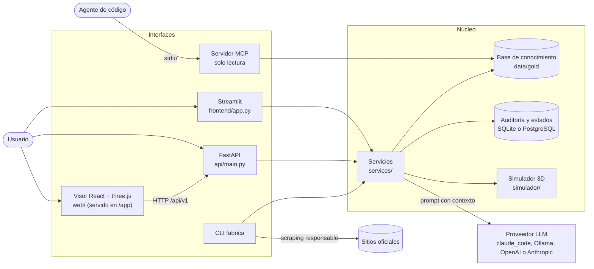

| Capa | Contenido |
|---|---|
| `domain` | Modelos Pydantic del dominio (fragmentos, respuestas) |
| `scraping` | Rastreador responsable, `robots.txt`, sitemaps, cliente HTTP |
| `pipelines` | Bronze, Silver, Gold, calidad y gráficas por etapa |
| `knowledge` | Base de conocimiento: carga, búsqueda BM25 y armado de contexto |
| `llm` | Cadenas LCEL, prompts versionados, salvaguardas y proveedores |
| `services` | `ServicioAsistente`, `ServicioSimulador`, fichas de motocicletas, FAQ del visor |
| `api`, `frontend`, `mcp_server`, `cli` | Interfaces: solo llaman a la capa de servicios |
| `simulador` | Modelo de componentes, cinemática, física, generación GLB (solo stdlib, Pydantic, numpy y trimesh) |

**Regla de dependencias:** `scraping → pipelines → knowledge → llm → services → interfaces`. Una capa solo importa
capas de nivel igual o inferior; `scripts/verificar_capas.py` lo comprueba. El acceso a SQL pasa por
`repositories/auditoria.py`. Las decisiones están en [`docs/arquitectura/adr/`](docs/arquitectura/adr/) (17 ADR) y
el árbol del repositorio en [`docs/arquitectura/arbol.txt`](docs/arquitectura/arbol.txt).

Diagramas completos: [`docs/arquitectura/diagramas/`](docs/arquitectura/diagramas/).

## Flujos
**Medallion**
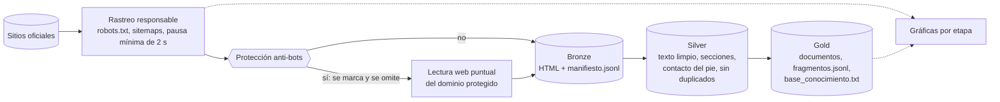

**Pregunta de Q&A**
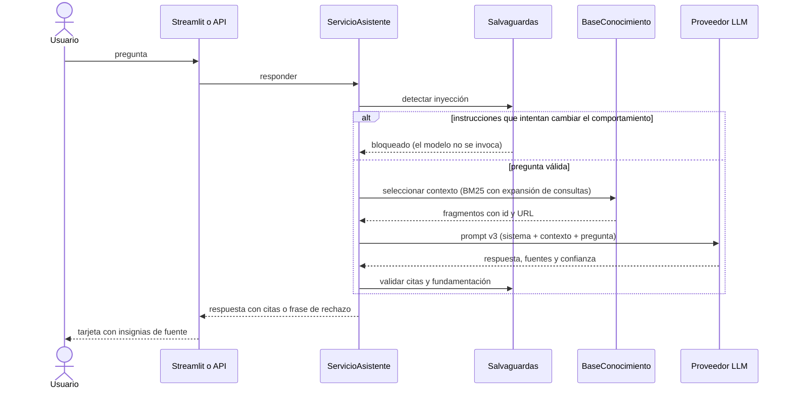

**Flujo funcional del usuario**
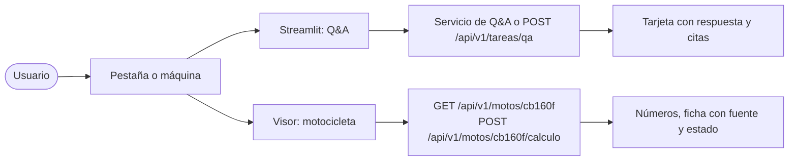

Simulador 3D y ciclo de vida del dato de la ficha: [`04_simulador_3d.md`](docs/arquitectura/diagramas/04_simulador_3d.md)
y [`05_ciclo_dato_ficha.md`](docs/arquitectura/diagramas/05_ciclo_dato_ficha.md). Modelo físico, supuestos y fuentes de la
motocicleta: [`docs/arquitectura/moto_honda.md`](docs/arquitectura/moto_honda.md).

## Capturas
| | |
|---|---|
| 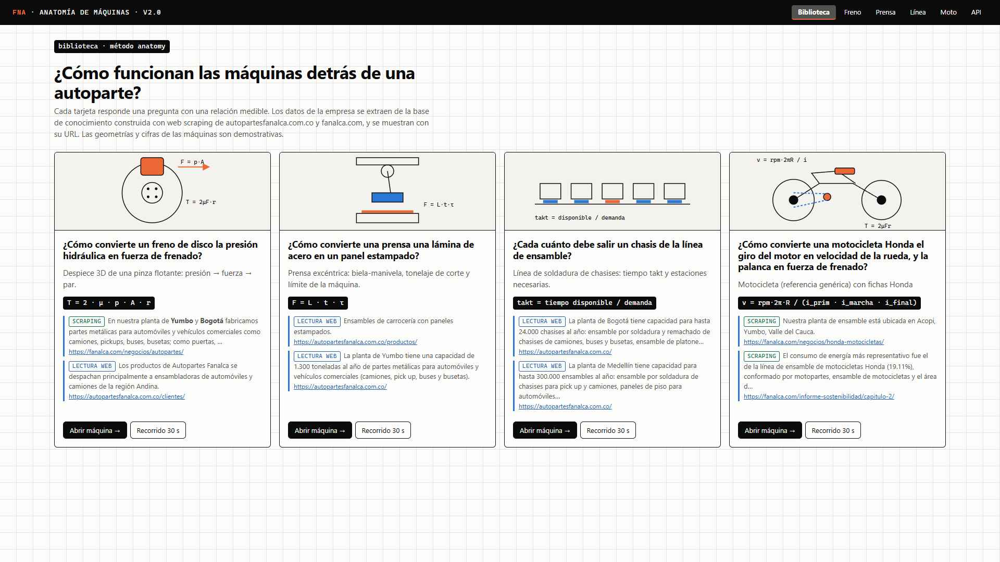<br/>Biblioteca de máquinas | 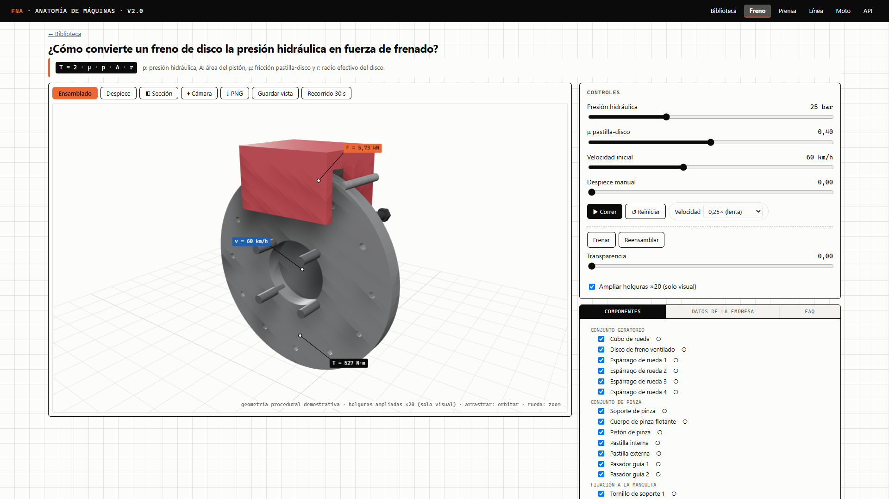<br/>Freno de disco |
| 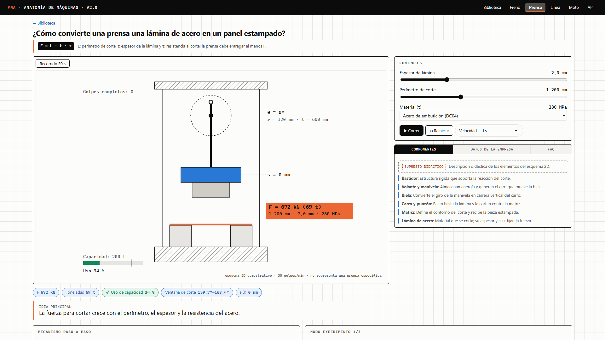<br/>Prensa de estampado | 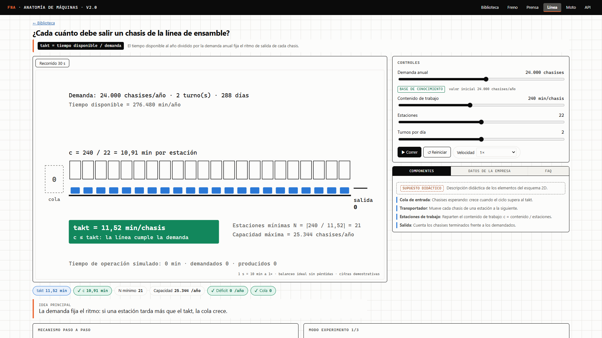<br/>Línea de ensamble |
| <br/>Motocicleta ensamblada | 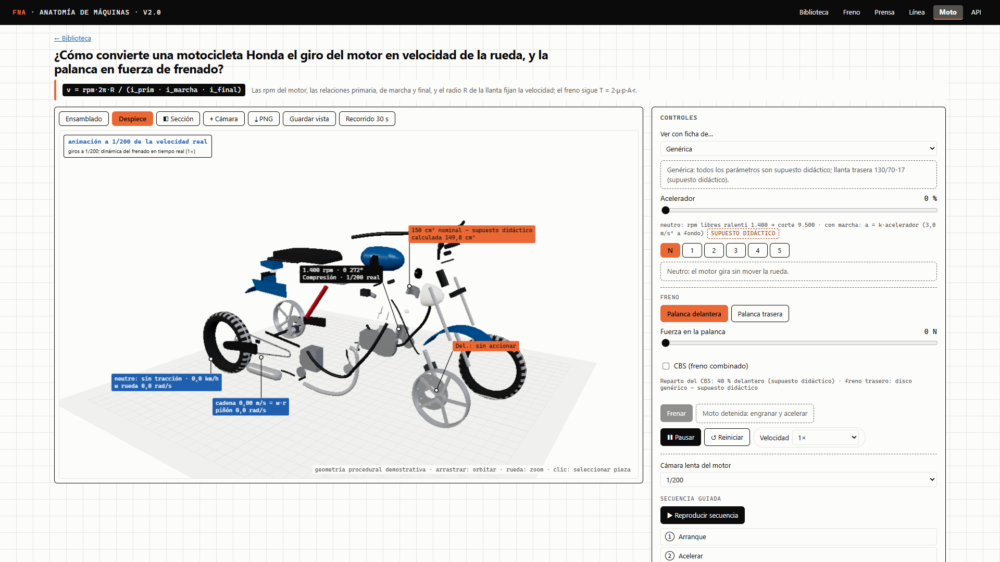<br/>Despiece radial por subconjunto |
| 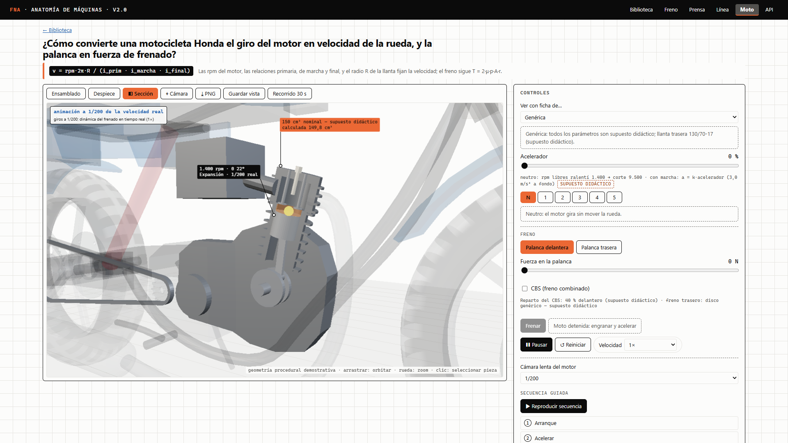<br/>Corte del motor | 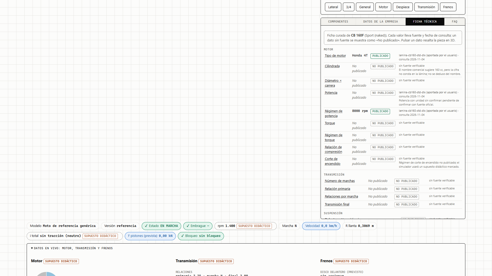<br/>Ficha técnica con fuente y estado |
| 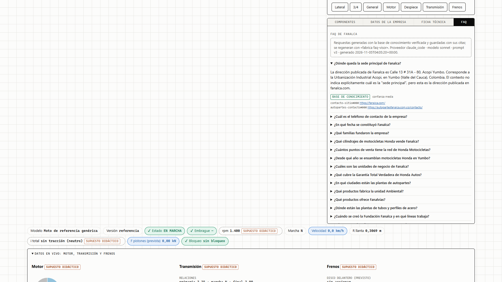<br/>FAQ de Fanalca con citas | 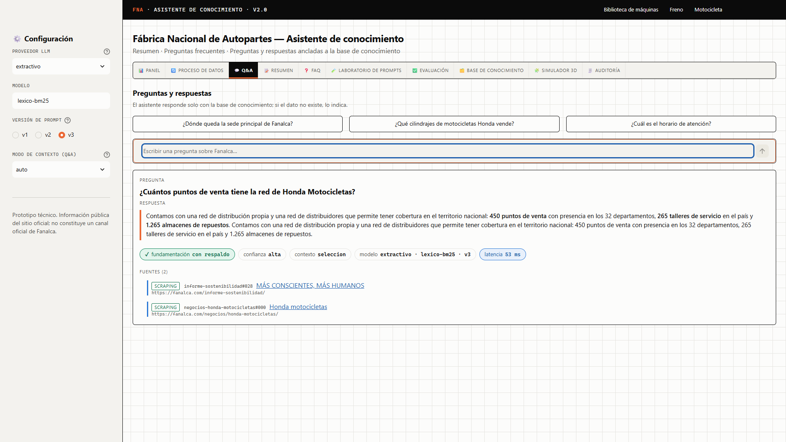<br/>Q&A en Streamlit |
| 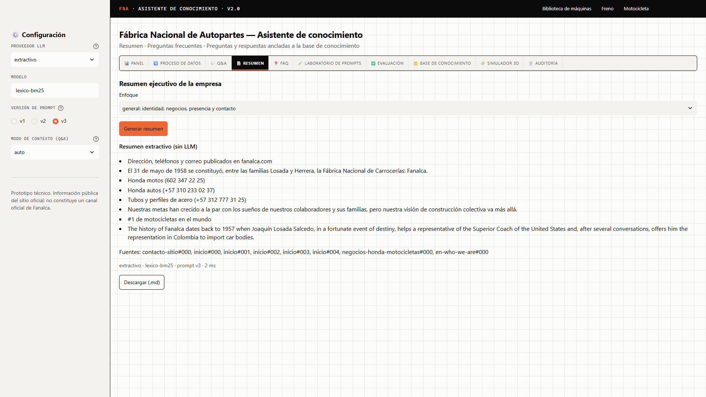<br/>Resumen | 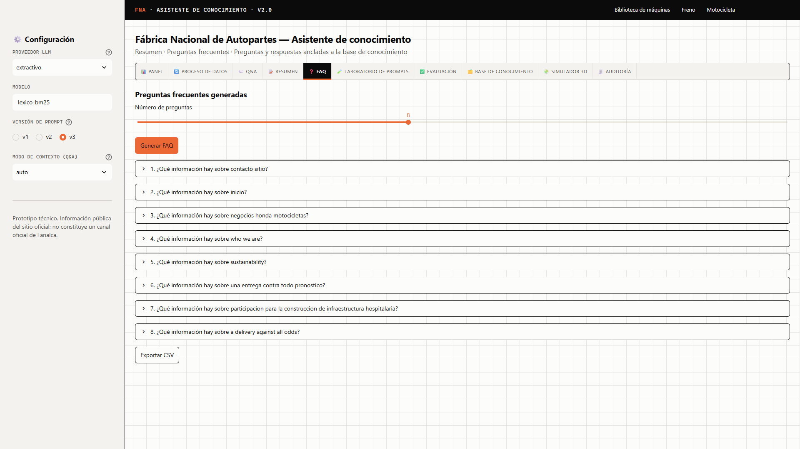<br/>FAQ |
| 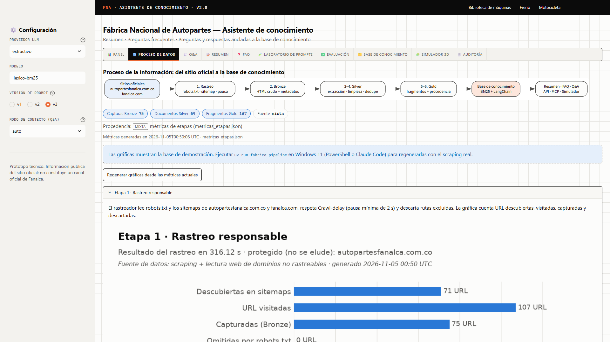<br/>Proceso de datos | 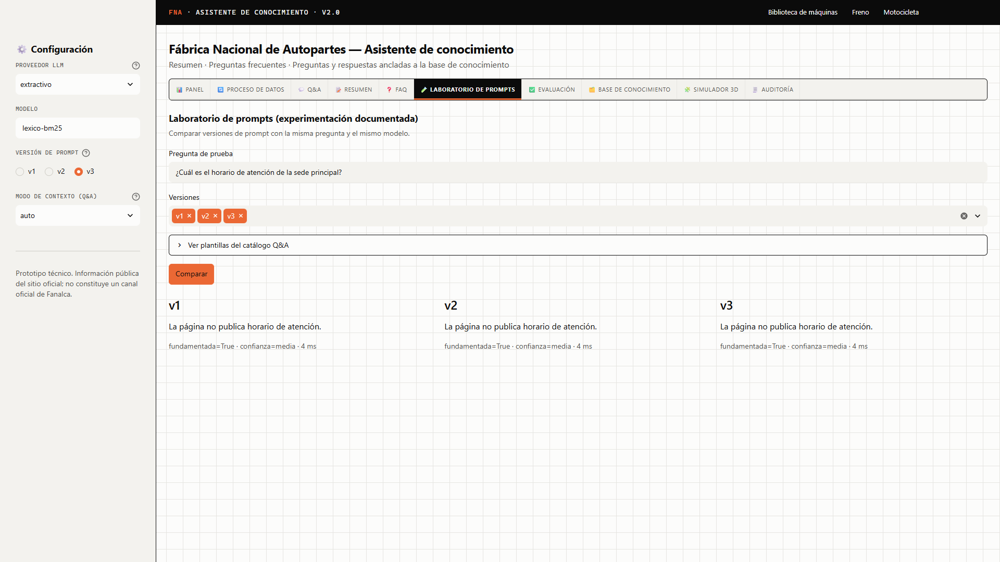<br/>Laboratorio de prompts |
| 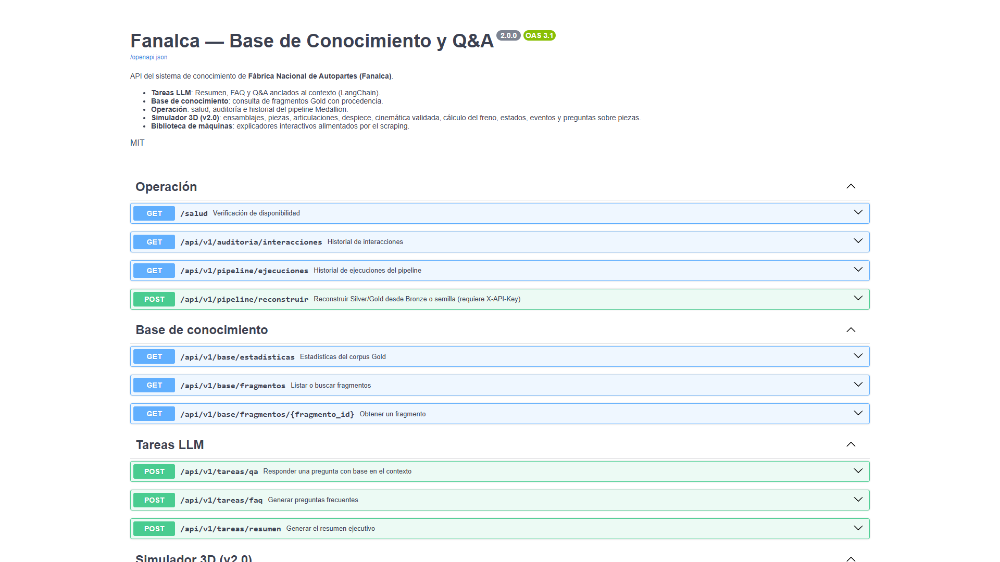<br/>API en Swagger | 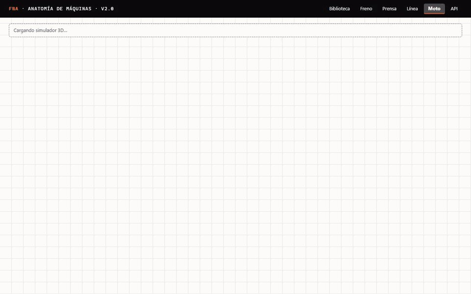<br/>Recorrido de la moto (GIF) |

## Inicio rápido en Windows 11
**Requisitos:** Python 3.12, [uv](https://docs.astral.sh/uv/), Node.js LTS, Git y Claude Code (para el proveedor
`claude_code`). Opcionales: Ollama, Docker Desktop (PostgreSQL), FFmpeg (videos) y GitHub CLI.

```powershell
cd C:\fabrica-nacional-autopartes
uv sync                                   # entorno reproducible desde uv.lock
cd web; npm ci; npm run build; cd ..      # visor 3D → web/dist (la API lo sirve en /app)
uv run fabrica build                      # base de conocimiento desde la semilla (sin red)
```

Ejecución (dos ventanas de PowerShell):
```powershell
uv run uvicorn fabrica_autopartes.api.main:app --host 127.0.0.1 --port 8000   # API y visor
uv run streamlit run frontend/app.py                                          # Streamlit
```

| Qué | URL |
|---|---|
| Streamlit | http://localhost:8501 |
| Visor y biblioteca | http://127.0.0.1:8000/app/ |
| Motocicleta | http://127.0.0.1:8000/app/#/maquina/moto_honda |
| Swagger | http://127.0.0.1:8000/docs |

Guion de demostración con URL, comandos y preguntas de ejemplo: [`docs/demo.md`](docs/demo.md). Instalación detallada de
herramientas: [`docs/manuales/instalacion_windows.md`](docs/manuales/instalacion_windows.md).

## Uso
| Comando | Descripción | Ejemplo |
|---|---|---|
| `fabrica pipeline` | Rastreo → Bronze → Silver/Gold → validación → gráficas (accede a la red) | `uv run fabrica pipeline --max-paginas 80` |
| `fabrica scrape` | Solo el rastreo (Bronze) | `uv run fabrica scrape --max-paginas 60` |
| `fabrica build` | Reconstruye Silver y Gold | `uv run fabrica build --fuente semilla` |
| `fabrica validate` | Valida procedencia, duplicados y datos personales del corpus | `uv run fabrica validate` |
| `fabrica graficas` | Regenera las seis gráficas por etapa | `uv run fabrica graficas` |
| `fabrica ask` | Pregunta al Q&A | `uv run fabrica ask "¿Dónde queda la sede principal?" --proveedor claude_code --modelo sonnet` |
| `fabrica faq` | Genera preguntas frecuentes | `uv run fabrica faq -n 8` |
| `fabrica summary` | Genera el resumen | `uv run fabrica summary --enfoque "negocios y productos"` |
| `fabrica evaluate` | Evalúa con el banco de 24 preguntas | `uv run fabrica evaluate --proveedor claude_code --modelo sonnet --version-prompt v3` |
| `fabrica faq-visor` | Precalcula `data/gold/faq_visor.json` para el visor | `uv run fabrica faq-visor` |
| `fabrica simulador` | Genera o valida el GLB de un ensamblaje | `uv run fabrica simulador generar --ensamblaje moto_honda` |
| `fabrica openapi` | Exporta `docs/api/openapi.json` | `uv run fabrica openapi` |

`fabrica pipeline` accede a la red y debe ejecutarse en el computador local, no dentro de las pruebas.

## API
Contrato completo en [`docs/api/openapi.json`](docs/api/openapi.json) (Swagger en `/docs`).

| Método | Ruta | Descripción |
|---|---|---|
| GET | `/salud` | Disponibilidad |
| GET | `/api/v1/base/estadisticas` · `/fragmentos` · `/fragmentos/{id}` | Corpus: estadísticas, búsqueda BM25 y fragmento por id |
| POST | `/api/v1/tareas/qa` · `/faq` · `/resumen` | Tareas LLM ancladas al contexto |
| GET | `/api/v1/auditoria/interacciones` | Historial paginado |
| GET / POST | `/api/v1/pipeline/ejecuciones` · `/reconstruir` | Historial y reconstrucción (`X-API-Key`) |
| GET | `/api/v1/maquinas` · `/maquinas/{id}` | Biblioteca de máquinas con datos de la empresa |
| GET / POST | `/api/v1/simulador/ensamblajes/{id}/…` | Jerarquía, piezas, articulaciones, despiece, cinemática validada, cálculo del freno, estados y eventos |
| GET | `/api/v1/motos` · `/motos/{id}` · `/motos/{id}/faq` | Fichas de motocicletas y preguntas del modelo (deterministas, con campo y fuente) |
| POST | `/api/v1/motos/{id}/calculo` | Cálculo didáctico; valida rpm, marcha, fuerza de palanca y versión (422 si es inválido) |
| GET | `/api/v1/faq-visor` | Respuestas precalculadas de Fanalca con citas |

## Servidor MCP
Servidor `fna-conocimiento` (solo lectura) para agentes de código: `uv run fabrica-mcp`, configurado en `.mcp.json`.

| Herramienta | Descripción |
|---|---|
| `buscar_fragmentos` | Búsqueda BM25 con filtro por sección |
| `obtener_fragmento` | Fragmento por id con su URL |
| `estadisticas_base` | Estadísticas del corpus |
| `validar_corpus` | Validación de calidad del corpus |
| `responder_pregunta` | Respuesta extractiva con citas |
| `consultar_pieza` | Pregunta sobre una pieza de un ensamblaje (`ensamblaje_id`, por defecto `freno_disco`) |

Todas las herramientas declaran `read_only_hint=True` y las salidas se tratan como datos, nunca como instrucciones.

## Proveedores LLM
| Proveedor | Descripción |
|---|---|
| `claude_code` | Claude mediante la CLI de Claude Code, sin clave de API (ADR-016): ejecuta `claude -p` con la sesión iniciada, en una carpeta temporal aislada y sin herramientas. Uso previsto: desarrollo y evaluación local. |
| `anthropic` / `openai` | Con clave de API |
| `ollama` | Modelo local (`llama3.2:3b` por defecto) |
| `extractivo` | Respaldo léxico BM25 sin red ni modelo; usado en las pruebas |

Variables de entorno (prefijo `FNA_`, valores solo en un `.env` local ignorado por Git; ver `.env.example`):

| Variable | Descripción |
|---|---|
| `FNA_PROVEEDOR_LLM`, `FNA_MODELO_LLM`, `FNA_VERSION_PROMPT` | Proveedor, modelo y versión de prompt |
| `FNA_MODO_CONTEXTO` | `auto`, `completo` o `seleccion` |
| `FNA_OLLAMA_URL`, `FNA_OLLAMA_NUM_CTX` | Ollama |
| `FNA_ANTHROPIC_API_KEY`, `FNA_OPENAI_API_KEY` | Claves de API (opcionales) |
| `FNA_URL_BASE_DATOS` | SQLite por defecto; PostgreSQL con `docker-compose.yml` |
| `FNA_API_CLAVE_ADMIN` | Clave de las rutas administrativas |
| `FNA_PAUSA_ENTRE_PETICIONES_S`, `FNA_MAX_PAGINAS` | Límites del rastreo |
| `FNA_URL_VISOR` | URL del visor enlazada desde Streamlit |

## Calidad
```powershell
$env:UV_NO_SYNC = "1"                       # solo si uv run falla por un ejecutable en uso (ver problemas frecuentes)
.\scripts\verificar_calidad.ps1 -ConE2E     # Ruff, mypy, capas, pytest, Vitest, build y Playwright
```
| Verificación | Estado |
|---|---|
| `pytest` | 269 pruebas (unitarias, integración, e2e de Streamlit) |
| Vitest | 99 pruebas (paridad Python y TypeScript del cálculo, plantilla, interfaz) |
| Playwright | 41 pruebas e2e del visor |
| Ruff, mypy y capas | Sin hallazgos |
| Integración continua | GitHub Actions en Ubuntu y Windows, más el visor |

Las pruebas no acceden a Internet (sitio simulado con `responses`) ni requieren GPU. Los resultados de cada corrida
quedan en [`docs/evidencias/`](docs/evidencias/). La trazabilidad de requisitos está en
[`docs/requisitos/matriz_trazabilidad.md`](docs/requisitos/matriz_trazabilidad.md).

**Evaluación v1–v3** (banco de 24 preguntas: 19 respondibles y 5 de rechazo; informes en
[`evaluacion/resultados/`](evaluacion/resultados/)):

| Proveedor y modo | Prompt | Exactitud en respondibles | Rechazo correcto | Fundamentada | Exactitud global |
|---|---|---|---|---|---|
| Extractivo, contexto completo | v1 · v2 · v3 | 0,632 | 0,4 | 0,842 | 0,583 |
| Extractivo, selección BM25 | v1 · v2 · v3 | 0,684 | 0,4 | 0,842 | 0,625 |
| Claude (`sonnet`), automático | v1 | 0,789 | 0,2 | 0,895 | 0,667 |
| Claude (`sonnet`), automático | v2 | 0,789 | 1,0 | 0,789 | 0,833 |
| Claude (`sonnet`), automático | v3 | 0,789 | 1,0 | 0,842 | 0,833 |
| Claude (`sonnet`), contexto completo | v3 | 0,737 | 1,0 | 0,579 | 0,792 |

Con Claude, el prompt v3 en modo automático iguala la exactitud global de v2 (0,833) y supera su tasa de
fundamentación (0,842 frente a 0,789); v1 no rechaza correctamente las preguntas ausentes. La latencia media con
Claude es de unos 3,5 a 4,5 s por respuesta.

## Datos y ética
- Scraping responsable: `robots.txt` y `Crawl-delay` respetados, User-Agent identificable
  (`FNA-KB/1.0 (+URL del repositorio)`), pausa mínima de 2 s y dominios permitidos.
- Protección anti-bots (ADR-015): un dominio que responde con un desafío se marca como protegido y se omite; no se
  elude. La base complementa con lectura web documentada (`origen: lectura_web`, con URL).
- Sin datos personales (Ley 1581 de 2012): los correos no corporativos se anonimizan en Silver.
- El corpus es contenido publicado por Fanalca y se cita con su fuente. Cada dato de empresa mostrado en el visor
  cita su URL y su origen (`scraping`, `lectura_web` o `semilla`).
- Cifras demostrativas y supuestos didácticos siempre marcados; la geometría no es diseño industrial certificado, la
  animación no valida propiedades mecánicas y no se generan procedimientos de reparación ni de seguridad.

## Estructura del proyecto
```
src/fabrica_autopartes/  core · domain · scraping · pipelines · knowledge · llm · simulador · repositories
                         services · api · mcp_server · cli.py
frontend/                Streamlit: app.py, estilo.py y estilo.css (tokens de web/src/tema)
web/                     Visor 3D y biblioteca de máquinas (Vite + React + three.js), pruebas Vitest y Playwright
data/                    seed · bronze · silver · gold · catalogo (fichas curadas)
evaluacion/              Banco de 24 preguntas y resultados
tests/                   unit · integration · e2e
alembic/                 Migraciones de la base de auditoría
skills/ openspec/ .mcp.json AGENTS.md   Skills del proyecto, especificaciones y reglas para agentes
docs/                    api · arquitectura (ADR, diagramas) · capturas · graficas · videos · evidencias · manuales
scripts/                 PowerShell y utilidades Python
infra/ docker-compose.yml .github/workflows/ci.yml postman/
```

## Limitaciones y hoja de ruta
**Limitaciones conocidas**
- La búsqueda es léxica (BM25 con expansión de consultas): no hay recuperación semántica con embeddings.
- Con un proveedor extractivo la respuesta no se sintetiza y puede no reconocer preguntas sin respuesta.
- Fichas de motocicletas: solo la CB 160F, con los datos de una lámina comercial; cilindrada, diámetro por carrera,
  relaciones de transmisión y potencia no están publicados y la simulación usa valores típicos marcados como supuesto.
- La moto es genérica y esquemática; el embrague no se modela y los discos usan un radio efectivo supuesto.
- El rendimiento del visor se midió con renderizado por software (SwiftShader), no con una GPU real.
- El sitio de Autopartes Fanalca responde con un desafío anti-bots: sus datos entran por lectura web, no por rastreo.

**Hoja de ruta técnica**
- Búsqueda web complementaria opcional, siempre iniciada por la persona usuaria, con los hallazgos en una cola de
  revisión humana y fuera de la base verificada.
- Recuperación semántica con embeddings.
- Más fichas de motocicletas a medida que existan fuentes oficiales legibles.
- Medición de rendimiento del visor en GPU real.

## Licencia
`pyproject.toml` declara la licencia MIT, pero el repositorio todavía no incluye un archivo `LICENSE`: queda pendiente
confirmar la licencia y añadirlo. El contenido del corpus es propiedad de Fanalca y se cita con su fuente; el modelo
3D lo genera el propio proyecto, sin modelos externos. Las dependencias conservan sus licencias (`uv tree`, `npm ls`).

## Problemas frecuentes
| Síntoma | Solución |
|---|---|
| `uv run` falla con «failed to remove file … fabrica-mcp.exe» | Definir `$env:UV_NO_SYNC = "1"` (o `uv run --no-sync`), o cerrar el servidor MCP y ejecutar `uv sync` |
| `/app` responde 404 | `cd web; npm ci; npm run build` y reiniciar la API |
| El despiece de la moto se ve plano | La API en ejecución es anterior a los cambios: reiniciarla |
| La FAQ de Fanalca del visor dice «Aún no hay respuestas» | `uv run fabrica faq-visor` (usa `claude_code`) |
| `proveedor_llm_no_disponible` | Iniciar sesión en Claude Code (`claude`) o usar el proveedor `extractivo` |
| `base_conocimiento_vacia` | `uv run fabrica build` |
| `fabrica pipeline` termina con código 2 | Ninguna página capturada: revisar `data/bronze/errores.jsonl` y la conexión |
