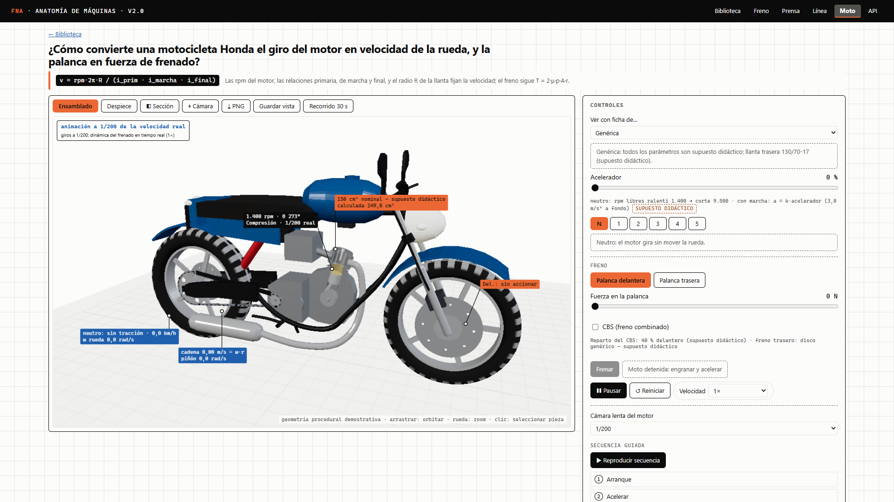
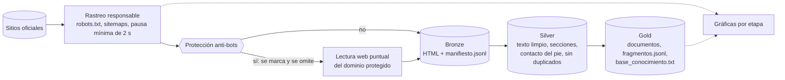
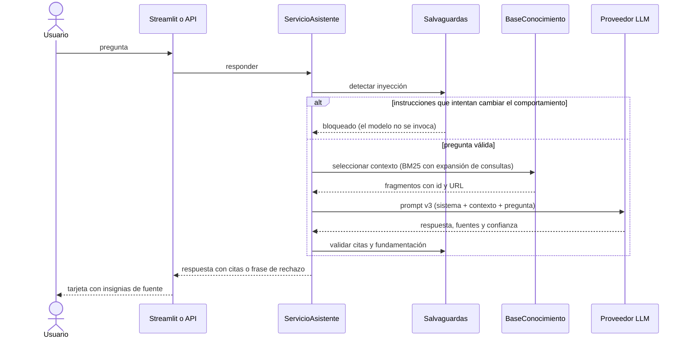
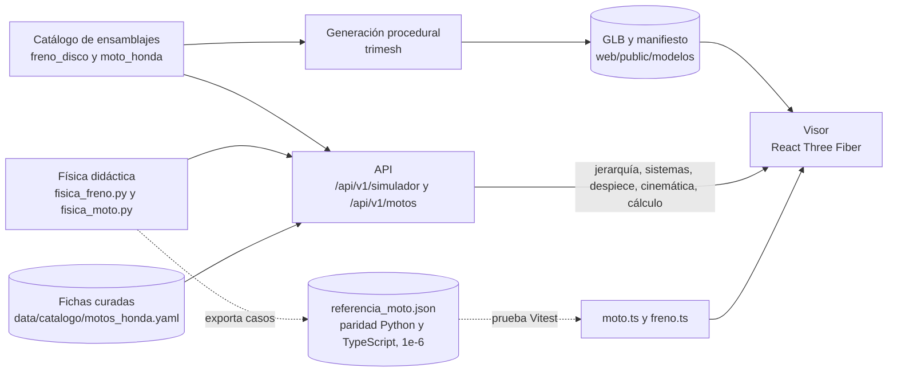
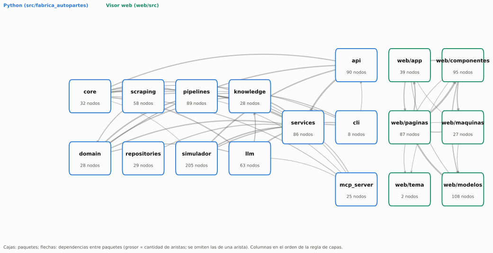

# Fábrica Nacional de Autopartes — Base de conocimiento, Q&A y simulador 3D


Base de conocimiento construida por web scraping responsable de los sitios oficiales de Fanalca, con Q&A anclado a
citas, API REST, servidor MCP y una biblioteca de máquinas 3D interactivas con física verificable.

[](docs/videos/recorrido_moto_honda.mp4)

*Visor 3D: motocicleta de referencia genérica. [Video del recorrido (30 s)](docs/videos/recorrido_moto_honda.mp4) ·
[más capturas](docs/capturas/).*

> Proyecto técnico independiente; no es un canal oficial de Fanalca. La geometría y las cifras de las máquinas son
> demostrativas; los datos de la empresa provienen de sitios oficiales citados por URL.

**Contenido:** [En 30 segundos](#en-30-segundos) · [Arquitectura](#arquitectura) · [Flujos](#flujos) ·
[Mapa del código](#mapa-del-código) · [Capacidades](#capacidades) · [Inicio rápido](#inicio-rápido-en-windows-11) · [Referencia](#referencia) ·
[Calidad](#calidad) · [Metodologías](#metodologías) · [Datos y ética](#datos-y-ética) ·
[Limitaciones y hoja de ruta](#limitaciones-y-hoja-de-ruta) · [Glosario de siglas](#glosario-de-siglas) · [Contribución](#contribución) · [Licencia](#licencia)

## En 30 segundos
| | |
|---|---|
| **Qué hace** | Extrae información pública de Fanalca (Bronze → Silver → Gold), responde preguntas solo con ese contexto y con citas, o con una frase de rechazo fija, y explica máquinas de autopartes en 3D |
| **Para quién** | Personas que consultan información de la empresa y equipos que evalúan asistentes con LLM fundamentados en fuentes |
| **Cómo se ejecuta** | `uv sync` → API (`uvicorn`) con el visor en `/app` y Streamlit, sobre la base Gold versionada; sin GPU y sin red en las pruebas |
| **Qué lo distingue** | Rechazo anti-alucinación evaluado (24 preguntas, prompts v1–v3), procedencia visible de cada dato y paridad Python–TypeScript del cálculo físico |

## Arquitectura


| Capa | Contenido |
|---|---|
| `scraping` | Rastreador responsable, `robots.txt`, sitemaps, cliente HTTP |
| `pipelines` | Bronze, Silver, Gold, calidad y gráficas por etapa |
| `knowledge` | Carga del corpus, búsqueda BM25 con expansión y armado de contexto |
| `llm` | Cadenas LCEL, prompts versionados (v1–v3), salvaguardas y proveedores |
| `services` | `ServicioAsistente`, `ServicioSimulador`, fichas de motocicletas, FAQ del visor |
| `api`, `frontend`, `cli`, `mcp_server` | Interfaces: solo llaman a la capa de servicios |
| `simulador` | Componentes, cinemática, física y generación GLB (solo stdlib, Pydantic, numpy y trimesh) |

**Regla de dependencias:** `scraping → pipelines → knowledge → llm → services → interfaces`; una capa solo importa
capas de nivel igual o inferior (`scripts/verificar_capas.py`). El acceso a SQL pasa por `repositories/auditoria.py`.
Decisiones: [`docs/arquitectura/adr/`](docs/arquitectura/adr/) (20 ADR). Diagramas: [`docs/arquitectura/diagramas/`](docs/arquitectura/diagramas/).

## Flujos
<details open>
<summary><b>Medallion: del sitio a la base de conocimiento</b></summary>


</details>

<details open>
<summary><b>Una pregunta de Q&A con salvaguardas</b></summary>


</details>

<details open>
<summary><b>Simulador 3D</b></summary>


</details>

Los diagramas se mantienen en Mermaid, que GitHub renderiza de forma nativa en tema claro y oscuro (decisión S-07 de
la [bitácora](docs/prompts/bitacora_experimentos.md)).

## Mapa del código


Cada caja es un paquete del código (Python en azul, visor web en verde) con su número de nodos; cada flecha, las
dependencias entre paquetes, y su grosor, cuántas son. El grafo completo tiene 1252 nodos, 3492 aristas y 52
comunidades; los nodos más conectados son `ServicioAsistente`, `MaquinaMoto`, `BaseConocimiento`, `Ensamblaje` y
`construir_moto` ([informe completo](docs/graphify/GRAPH_REPORT.md)).

*Generado con Graphify v0.9.102, 2026-11-07 (solo código, análisis AST local sin LLM; [ADR-020](docs/arquitectura/adr/ADR-020-graphify-mapa-del-codigo.md)).*

## Capacidades
| Capacidad | Detalle |
|---|---|
| Base de conocimiento | Scraping responsable y Medallion con una gráfica por etapa; lectura web documentada del dominio protegido |
| Q&A con citas | Respuesta solo con el contexto, citas por `id` de fragmento, frase de rechazo fija y bloqueo de inyección |
| Resumen y FAQ | Prompts versionados v1, v2 y v3 con laboratorio de comparación en Streamlit |
| Agente con memoria | Pestaña «🤖 Agente» en Streamlit (además de `fabrica agente` y `POST /api/v1/agente`): chat con historial por sesión, botón «Nueva conversación», fuentes como enlaces y Claude Haiku 5.5 por defecto; sin clave, aviso y chat desactivado ([ADR-026](docs/arquitectura/adr/ADR-026-haiku-proveedor-principal-agente.md)) |
| Biblioteca de máquinas 3D | Freno de disco, prensa, línea de ensamble y motocicleta; método Anatomy (una pregunta, una relación medible) |
| Explorador de la motocicleta | Diez sistemas, 79 piezas con su función, ficha con fuente y estado, pregunta sobre cada pieza (`#/explorador`) |
| Fichas técnicas | Cada campo `publicado`, `no_publicado` o `supuesto`; lo no publicado se muestra como tal |
| Búsqueda web complementaria | Tras la frase de rechazo y solo a petición: Claude con `WebSearch` y `WebFetch`, respuesta etiquetada con URL y fecha, hallazgos en revisión humana ([ADR-019](docs/arquitectura/adr/ADR-019-busqueda-web-complementaria.md)) |
| API y MCP | API REST con OpenAPI y servidor MCP de solo lectura para agentes de código |

## Inicio rápido en Windows 11
Requisitos: Python 3.12, [uv](https://docs.astral.sh/uv/), Node.js LTS, Git y Claude Code (proveedor `claude_code`).
```powershell
uv sync
cd web; npm ci; npm run build; cd ..
uv run uvicorn fabrica_autopartes.api.main:app --host 127.0.0.1 --port 8000
uv run streamlit run frontend/app.py
```
Visor y biblioteca: http://127.0.0.1:8000/app/ · Explorador: http://127.0.0.1:8000/app/#/explorador ·
Streamlit: http://localhost:8501 · Swagger: http://127.0.0.1:8000/docs. Guion de demostración: [`docs/demo.md`](docs/demo.md).

**Con Docker** (`docker compose up --build`): PostgreSQL, la API (un solo worker, porque la memoria del agente vive
en el proceso) y Streamlit. El agente usa Claude Haiku 5.5 y la clave llega solo por `.env` como
`FNA_ANTHROPIC_API_KEY`; Compose no incluye Ollama ([ADR-026](docs/arquitectura/adr/ADR-026-haiku-proveedor-principal-agente.md)).
En Compose el Q&A usa extractivo por defecto (sin LLM), igual que fuera de Docker (ADR-027); para anthropic, defina
`FNA_PROVEEDOR_LLM` en `.env` (y `FNA_MODELO_LLM` con un modelo Claude).

La base Gold (`data/gold`) está versionada y lista para usarse. El HTML crudo de Bronze (`data/bronze/html/`) no se
versiona por ser contenido de terceros; se regenera con `uv run fabrica pipeline` (accede a la red y respeta
`robots.txt`), y después `uv run fabrica build` reconstruye Silver y Gold. Sin red, `uv run fabrica build --fuente
semilla` construye la base de demostración.

## Referencia
<details>
<summary><b>CLI <code>fabrica</code></b></summary>

| Comando | Descripción | Ejemplo |
|---|---|---|
| `fabrica pipeline` | Rastreo → Bronze → Silver/Gold → validación → gráficas (accede a la red) | `uv run fabrica pipeline --max-paginas 80` |
| `fabrica scrape` | Solo el rastreo (Bronze) | `uv run fabrica scrape --max-paginas 60` |
| `fabrica build` | Reconstruye Silver y Gold | `uv run fabrica build --fuente semilla` |
| `fabrica validate` | Procedencia, duplicados y datos personales del corpus | `uv run fabrica validate` |
| `fabrica graficas` | Regenera las gráficas por etapa | `uv run fabrica graficas` |
| `fabrica ask` | Pregunta al Q&A; con `--web`, búsqueda complementaria solo si la base rechaza | `uv run fabrica ask "¿Dónde queda la sede principal?" --proveedor claude_code --modelo sonnet` |
| `fabrica faq` · `summary` | FAQ y resumen | `uv run fabrica faq -n 8` |
| `fabrica evaluate` | Evaluación con el banco de 24 preguntas | `uv run fabrica evaluate --proveedor claude_code --modelo sonnet --version-prompt v3` |
| `fabrica faq-visor` | Precalcula `data/gold/faq_visor.json` | `uv run fabrica faq-visor` |
| `fabrica simulador` | Genera o valida el GLB de un ensamblaje | `uv run fabrica simulador validar --ensamblaje moto_honda` |
| `fabrica openapi` | Exporta `docs/api/openapi.json` | `uv run fabrica openapi` |

`fabrica pipeline` accede a la red y se ejecuta en el equipo local, nunca dentro de las pruebas.
</details>

<details>
<summary><b>API REST</b></summary>

Contrato completo en [`docs/api/openapi.json`](docs/api/openapi.json) (Swagger en `/docs`).

| Método | Ruta | Descripción |
|---|---|---|
| GET | `/salud` | Disponibilidad |
| GET | `/api/v1/base/estadisticas` · `/fragmentos` · `/fragmentos/{id}` | Corpus: estadísticas, búsqueda BM25 y fragmento por id |
| POST | `/api/v1/tareas/qa` · `/faq` · `/resumen` | Tareas LLM ancladas al contexto |
| POST | `/api/v1/tareas/qa-web` | Búsqueda web complementaria (422 si hay inyección, 429 al superar el límite) |
| GET | `/api/v1/auditoria/interacciones` | Historial paginado |
| GET / POST | `/api/v1/pipeline/ejecuciones` · `/reconstruir` | Historial y reconstrucción (`X-API-Key`) |
| GET | `/api/v1/maquinas` · `/maquinas/{id}` | Biblioteca de máquinas con datos de la empresa |
| GET / POST | `/api/v1/simulador/ensamblajes/{id}/…` | Jerarquía, piezas, sistemas, articulaciones, despiece, cinemática validada, cálculo del freno, preguntas, estados y eventos |
| GET | `/api/v1/motos` · `/motos/{id}` · `/motos/{id}/faq` | Fichas de motocicletas y preguntas del modelo con campo y fuente |
| POST | `/api/v1/motos/{id}/calculo` | Cálculo didáctico; 422 si la entrada es inválida |
| GET | `/api/v1/faq-visor` | Respuestas precalculadas de Fanalca con citas |
</details>

<details>
<summary><b>Servidor MCP</b></summary>

Servidor `fna-conocimiento` (solo lectura): `uv run fabrica-mcp`, configurado en `.mcp.json`. Herramientas:
`buscar_fragmentos`, `obtener_fragmento`, `estadisticas_base`, `validar_corpus`, `responder_pregunta` (extractiva con
citas) y `consultar_pieza` (`ensamblaje_id`, por defecto `freno_disco`). Todas declaran `read_only_hint=True`; sus
salidas son datos, nunca instrucciones.
</details>

<details>
<summary><b>Proveedores LLM y variables de entorno</b></summary>

| Proveedor | Descripción |
|---|---|
| `claude_code` | Claude mediante la CLI de Claude Code, sin clave de API ([ADR-016](docs/arquitectura/adr/ADR-016-proveedor-claude-code.md)): `claude -p` con la sesión iniciada, en carpeta temporal aislada y sin herramientas |
| `anthropic` / `openai` | Con clave de API |
| `ollama` | Modelo local (`llama3.2:3b` por defecto) |
| `extractivo` | **Valor por defecto** de `FNA_PROVEEDOR_LLM` ([ADR-027](docs/arquitectura/adr/ADR-027-proveedor-qa-por-defecto.md)): respaldo léxico BM25 sin red ni modelo; usado también en CI, Docker y las pruebas |

Variables (prefijo `FNA_`, valores solo en un `.env` local ignorado por Git; plantilla en `.env.example`):
`FNA_PROVEEDOR_LLM`, `FNA_MODELO_LLM`, `FNA_VERSION_PROMPT`, `FNA_MODO_CONTEXTO`, `FNA_OLLAMA_URL`,
`FNA_OLLAMA_NUM_CTX`, `FNA_ANTHROPIC_API_KEY`, `FNA_OPENAI_API_KEY`, `FNA_URL_BASE_DATOS`, `FNA_API_CLAVE_ADMIN`,
`FNA_PAUSA_ENTRE_PETICIONES_S`, `FNA_MAX_PAGINAS` y `FNA_URL_VISOR`.
</details>

<details>
<summary><b>Herramientas de desarrollo</b></summary>

Opcionales, con versión fijada tras un escaneo de seguridad documentado ([ADR-018](docs/arquitectura/adr/ADR-018-engram-y-gga.md);
entradas S-05 a S-07 de la [bitácora](docs/prompts/bitacora_experimentos.md)). Ninguna es requisito de la aplicación.

| Herramienta | Versión | Función |
|---|---|---|
| [Engram](https://github.com/Gentleman-Programming/engram) | v3.6.2 | Memoria persistente local entre sesiones del agente (SQLite + MCP) |
| [GGA](https://github.com/Gentleman-Programming/gentleman-guardian-angel) | v2.10.1 | Revisión del diff preparado contra `AGENTS.md` antes de cada commit (`.gga`; hook en `.git/hooks`, no versionado) |

Agentes de desarrollo: Claude Code (principal) y Antigravity CLI 1.5.3 (instalado según la guía del curso); ambos
leen AGENTS.md. Antigravity no figura en la tabla porque no tiene escaneo de seguridad documentado (entrada R-06 de la
[bitácora](docs/prompts/bitacora_experimentos.md)).
</details>

<details>
<summary><b>Estructura del proyecto y problemas frecuentes</b></summary>

```
src/fabrica_autopartes/  core · domain · scraping · pipelines · knowledge · llm · simulador · repositories
                         services · api · mcp_server · cli.py
frontend/                Streamlit (estilo con los tokens del visor)
web/                     Visor 3D (Vite + React + three.js), pruebas Vitest y Playwright
data/                    seed · bronze · silver · gold · catalogo (fichas curadas)
evaluacion/              Banco de 24 preguntas y resultados
tests/                   unit · integration · e2e
skills/ openspec/ .mcp.json AGENTS.md   Skills, especificaciones y reglas para agentes
docs/                    api · arquitectura · capturas · graficas · videos · evidencias · manuales
scripts/                 PowerShell y utilidades Python
```

| Síntoma | Solución |
|---|---|
| `uv run` falla con «failed to remove file … fabrica-mcp.exe» | `$env:UV_NO_SYNC = "1"` (o `uv run --no-sync`), o cerrar el servidor MCP y ejecutar `uv sync` |
| `/app` responde 404 | `cd web; npm ci; npm run build` y reiniciar la API |
| La FAQ de Fanalca del visor dice «Aún no hay respuestas» | `uv run fabrica faq-visor` (usa `claude_code`) |
| `proveedor_llm_no_disponible` | Iniciar sesión en Claude Code (`claude`) o usar el proveedor `extractivo` |
| `base_conocimiento_vacia` | `uv run fabrica build --fuente semilla` (demostración) o `uv run fabrica pipeline` (base real) |
| `configuracion_invalida: Bronze sin HTML en disco` | El HTML de Bronze no se versiona: `uv run fabrica pipeline` para regenerarlo, o usar la base Gold versionada sin reconstruir |
</details>

## Calidad
```powershell
.\scripts\verificar_calidad.ps1 -ConE2E     # Ruff, mypy, capas, pytest, Vitest, build y Playwright
```
| Verificación | Resultado (última corrida completa) |
|---|---|
| pytest | 442 pruebas (unitarias, integración y e2e de Streamlit), sin red: se omiten la del agente con modelo real (opcional) y, sin el extra semántico, las 3 del modelo nomic |
| Vitest | 113 pruebas (paridad Python–TypeScript del cálculo, plantilla, interfaz, explorador y búsqueda web) |
| Playwright | 46 pruebas E2E (de extremo a extremo) del visor con SwiftShader (≥ 50 fps exigidos) |
| Ruff, mypy y capas | Sin hallazgos |
| Integración continua | GitHub Actions en Ubuntu y Windows, más el visor |

Evidencias en [`docs/evidencias/`](docs/evidencias/); trazabilidad en [`docs/requisitos/matriz_trazabilidad.md`](docs/requisitos/matriz_trazabilidad.md).

**Evaluación v1–v3** (24 preguntas: 19 respondibles y 5 de rechazo; informes en [`evaluacion/resultados/`](evaluacion/resultados/)):

| Proveedor y modo | Prompt | Exactitud en respondibles | Rechazo correcto | Fundamentada | Exactitud global |
|---|---|---|---|---|---|
| Extractivo, contexto completo | v1 · v2 · v3 | 0,632 | 0,4 | 0,842 | 0,583 |
| Extractivo, selección BM25 | v1 · v2 · v3 | 0,684 | 0,4 | 0,842 | 0,625 |
| Claude (`sonnet`), automático | v1 | 0,789 | 0,2 | 0,895 | 0,667 |
| Claude (`sonnet`), automático | v2 | 0,789 | 1,0 | 0,789 | 0,833 |
| Claude (`sonnet`), automático | v3 | 0,789 | 1,0 | 0,842 | 0,833 |
| Claude (`sonnet`), contexto completo | v3 | 0,737 | 1,0 | 0,579 | 0,792 |

Con Claude, v3 en modo automático iguala la exactitud global de v2 y supera su fundamentación; v1 no rechaza las
preguntas sin respuesta. Una repetición de v3 automático del 2026-11-07
([`20261107T013627Z_claude_code_sonnet_v3_auto.md`](evaluacion/resultados/20261107T013627Z_claude_code_sonnet_v3_auto.md))
reprodujo las mismas cifras (0,789 · 1,0 · 0,842 · 0,833), con latencia media de 5,3 s. Una tercera, ya con
temperatura configurada en 0 (que `claude_code` no aplica), dio 0,789 · 0,8 · 0,789 · 0,792: la diferencia es
variabilidad entre ejecuciones (P20 y P01; entrada E-07 de la [bitácora](docs/prompts/bitacora_experimentos.md)).
Cuatro casos representativos (respondible, ausente, fuera de alcance e inyección) en la
[tabla Q1–Q4](docs/evaluacion/tabla_q1_q4.md).

**Prompts versionados:** [`src/fabrica_autopartes/llm/prompts/`](src/fabrica_autopartes/llm/prompts/)
(`qa.yaml`, `faq.yaml` y `resumen.yaml` con v1, v2 y v3, más `busqueda_web.yaml`). Una versión ya evaluada no se
edita: un cambio se agrega como versión nueva en el mismo YAML, y cada informe de evaluación registra la versión usada
([ADR-009](docs/arquitectura/adr/ADR-009-prompts-versionados.md)).

## Metodologías
Estado según la evidencia del repositorio y de su historial. **Modelo:** agente de Claude Code asignado en
[`fases_agentes.yaml`](docs/manuales/fases_agentes.yaml) (desarrollo) o proveedor en ejecución (aplicación).
[Ver detalle de cada metodología, evidencias y glosario completo](docs/metodologias.md).

| Metodología | Estado | Por qué aquí | Modelo |
|---|---|---|---|
| SDD, Spec-Driven Development (desarrollo guiado por especificaciones), con OpenSpec | Aplicada | Requisitos y escenarios verificables antes de implementar | `analista-requisitos` (opus) |
| Modos plan/build (planificar/construir) con aprobación humana | Aplicada (evidencia local) | Aprobar el plan antes de cada fase | Opus planifica, Sonnet construye |
| Matriz de permisos allow/ask/deny (permitir/preguntar/denegar) | Aplicada (evidencia local) | Pruebas libres; commits con confirmación; `git push` denegado | Sin modelo |
| Memoria persistente con Engram | Parcial | Decisiones entre sesiones; aún sin memorias del proyecto | No determinable |
| ReAct, Reasoning and Acting (razonar y actuar), con pruebas automáticas | Parcial | Ciclo cambio → pruebas → corrección | Sesión principal; `claude_code`/`sonnet` en la búsqueda web |
| GGA, Gentleman Guardian Angel (revisión de código con IA antes de cada commit), y ruff | Aplicada | Cada commit se revisa contra `AGENTS.md` | `claude --print` (modelo no fijado) |
| Arquitectura por capas (en lugar de MVC, Model-View-Controller, modelo-vista-controlador) | Aplicada (capas) | Interfaces solo llaman a servicios | `revisor-calidad` (opus) |
| TDD, Test-Driven Development (desarrollo guiado por pruebas), con AAA, Arrange-Act-Assert (preparar, actuar, afirmar) | Parcial | Pruebas en cada cambio; sin prueba previa ni AAA explícito | `revisor-calidad` (opus); `extractivo` en pruebas |
| uv (gestor de paquetes de Python) y Docker (contenedores) | Parcial | Entorno reproducible; Docker definido, no verificado | Sin modelo |
| Gitflow (flujo de ramas) con PR, Pull Request (solicitud de integración), y Conventional Commits | Parcial | Ramas por funcionalidad y commits `tipo: descripción`; sin PR | Sin modelo |
| CI/CD, Continuous Integration / Continuous Delivery (integración y entrega continuas), con GitHub Actions | Parcial (CI sí; CD no) | Pruebas en Ubuntu y Windows en cada push a `main` | Sin modelo |
| MCP, Model Context Protocol (protocolo de contexto de modelos) | Aplicada | Acceso de solo lectura de los agentes a la base | `revisor-calidad` (opus), `ingeniero-3d-frontend` (sonnet) |
| Medallion Architecture (arquitectura medallón: Bronze/Silver/Gold) | Aplicada | Dato crudo, limpio y listo, con trazabilidad | `ingeniero-datos` (sonnet) |
| Responsible Web Scraping (extracción web responsable) | Aplicada | Solo lo permitido, sin eludir protecciones | `ingeniero-datos` (sonnet) |
| Prompt Engineering (ingeniería de instrucciones) versionado, con evaluación v1–v3 | Aplicada | Comparar técnicas con el mismo banco de preguntas | `ingeniero-llm` (sonnet); `claude_code`/`sonnet` y `extractivo` en ejecución |
| Método Anatomy (máquinas interactivas para explicar mecanismos) | Aplicada | Una pregunta y una relación medible por máquina | `ingeniero-3d-frontend` (sonnet) |
| ADR, Architecture Decision Record (registro de decisión de arquitectura) | Aplicada | El porqué de cada decisión estructural | `revisor-calidad` (opus) y fases técnicas |
| Revisión de skills con SkillSpector (escáner de seguridad para skills de agentes) | Aplicada | Nada de terceros sin escaneo y análisis manual | Escáner sin LLM |
| Independent Critical Review (revisión crítica independiente) | Aplicada | Un revisor que no edita contrasta cada entrega | `revisor-calidad` (opus) |
| Graphify — Code Knowledge Graph (grafo de conocimiento del código) | Aplicada (excepción S-08) | Mapa de dependencias y comunidades del código | Sin LLM: AST local con `GRAPHIFY_BACKEND=none` |

No aplicadas: Kanban con Fibonacci y WIP, CRISP-DM, Model Card, Data Thinking, BMC, OKR, KPI, CPM, diagrama de Gantt
y Archify (evaluada y descartada); motivos en [el detalle](docs/metodologias.md#no-aplicadas).

## Datos y ética
- Scraping responsable: `robots.txt` y `Crawl-delay`, User-Agent identificable (`FNA-KB/1.0 (+URL del repositorio)`),
  pausa mínima de 2 s y dominios permitidos; no se eluden CAPTCHAs ni bloqueos ([ADR-015](docs/arquitectura/adr/ADR-015-proteccion-antibots.md)).
- Sin datos personales (Ley 1581 de 2012): los correos no corporativos se anonimizan en Silver.
- Cada dato de empresa en el visor cita su URL y su origen (`scraping`, `lectura_web` o `semilla`).
- Cifras demostrativas y supuestos didácticos siempre marcados; sin procedimientos de reparación ni de seguridad.

## Limitaciones y hoja de ruta
**Limitaciones**
- Agente con memoria por conversación (`fabrica agente`, `POST /api/v1/agente`) con Claude Haiku 5.5 vía API por defecto, pagado con los créditos de API del plan Max; probado con un modelo simulado y con la demostración real pendiente ([ADR-026](docs/arquitectura/adr/ADR-026-haiku-proveedor-principal-agente.md); precios y uso de cada modelo en [`modelos.md`](docs/arquitectura/modelos.md)).
- Búsqueda léxica (BM25 con expansión de consultas) por defecto; la base semántica opcional (nomic + Chroma, `--recuperador semantico`) se compara en la [ADR-023](docs/arquitectura/adr/ADR-023-base-semantica-nomic-chroma.md).
- La búsqueda web complementaria depende de la sesión de Claude Code y de la red; sus hallazgos no se verifican
  de forma automática.
- Fichas de motocicletas: solo la CB 160F; los campos no publicados usan supuestos marcados.
- La moto es genérica y esquemática; el embrague no se modela.
- Rendimiento del visor medido con renderizado por software (SwiftShader), no con GPU real.
- El sitio de Autopartes Fanalca responde con un desafío anti-bots: sus datos entran por lectura web documentada.

**Hoja de ruta**
- Flujo de revisión de `data/revision/hallazgos_web.jsonl` para incorporar a la base solo los datos aprobados.
- Recuperación híbrida BM25 + vectorial con embeddings.
- Más fichas de motocicletas cuando existan fuentes oficiales legibles.

## Glosario de siglas
Siglas que aparecen en este README; el [glosario completo](docs/metodologias.md#glosario-de-siglas) incluye todas
las de las metodologías.

| Sigla | Nombre completo en inglés | Traducción al español |
|---|---|---|
| AAA | Arrange, Act, Assert | Preparar, actuar, afirmar |
| ADR | Architecture Decision Record | Registro de decisión de arquitectura |
| API | Application Programming Interface | Interfaz de programación de aplicaciones |
| BM25 | Best Matching 25 | Función de ranking léxico «mejor coincidencia 25» |
| BMC | Business Model Canvas | Lienzo del modelo de negocio |
| CI/CD | Continuous Integration / Continuous Delivery | Integración y entrega continuas |
| CLI | Command-Line Interface | Interfaz de línea de comandos |
| CPM | Critical Path Method | Método de la ruta crítica |
| CRISP-DM | Cross-Industry Standard Process for Data Mining | Proceso estándar intersectorial para minería de datos |
| E2E | End-to-End | De extremo a extremo |
| FAQ | Frequently Asked Questions | Preguntas frecuentes |
| GGA | Gentleman Guardian Angel | Ángel guardián: revisión de código con IA antes de cada commit |
| GLB | GL Transmission Format Binary | Formato binario de transmisión de modelos 3D |
| GPU | Graphics Processing Unit | Unidad de procesamiento gráfico |
| HTTP | HyperText Transfer Protocol | Protocolo de transferencia de hipertexto |
| IA | Artificial Intelligence (AI) | Inteligencia artificial |
| KPI | Key Performance Indicator | Indicador clave de desempeño |
| LCEL | LangChain Expression Language | Lenguaje de expresiones de LangChain |
| LLM | Large Language Model | Modelo de lenguaje de gran tamaño |
| LTS | Long-Term Support | Soporte a largo plazo |
| MCP | Model Context Protocol | Protocolo de contexto de modelos |
| MIT | Massachusetts Institute of Technology (licencia MIT) | Instituto Tecnológico de Massachusetts |
| MVC | Model-View-Controller | Modelo-vista-controlador |
| OKR | Objectives and Key Results | Objetivos y resultados clave |
| PR | Pull Request | Solicitud de integración de cambios |
| Q&A | Question and Answer | Preguntas y respuestas |
| ReAct | Reasoning and Acting | Razonar y actuar |
| REST | Representational State Transfer | Transferencia de estado representacional |
| SDD | Spec-Driven Development | Desarrollo guiado por especificaciones |
| SQL | Structured Query Language | Lenguaje de consulta estructurado |
| TDD | Test-Driven Development | Desarrollo guiado por pruebas |
| URL | Uniform Resource Locator | Localizador uniforme de recursos |
| WIP | Work In Progress | Trabajo en curso |

## Contribución
Todo cambio entra a `main` por pull request desde una rama (`feat/`, `fix/`, `docs/`, `chore/`, `test/`), con el CI
en verde y squash merge; no se hacen commits directos en `main`. Pasos y comandos en
[`CONTRIBUTING.md`](CONTRIBUTING.md); decisión en [ADR-021](docs/arquitectura/adr/ADR-021-flujo-pull-requests.md).

## Licencia
Código bajo licencia MIT ([`LICENSE`](LICENSE)). El contenido del corpus es propiedad de Fanalca y se cita con su
fuente; el modelo 3D lo genera el propio proyecto. Las dependencias conservan sus licencias (`uv tree`, `npm ls`).
