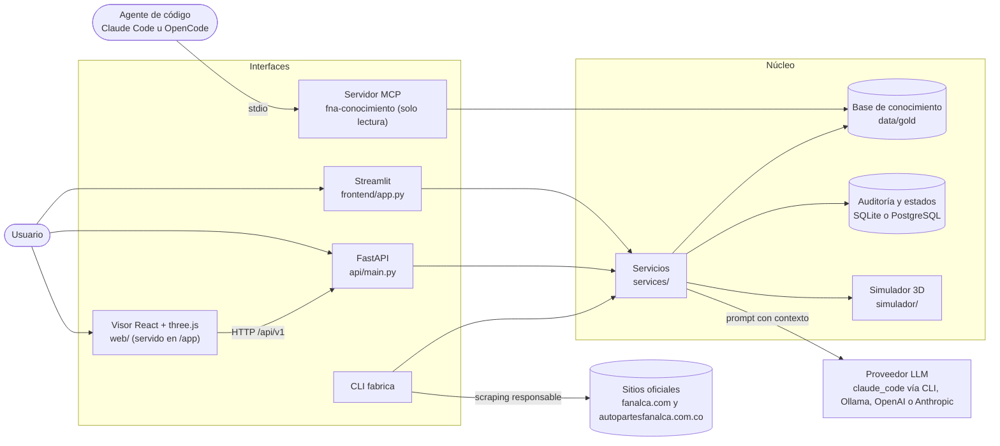

# Arquitectura de ejecución

Componentes que existen en el código y cómo se comunican en ejecución. Las interfaces solo llaman a la capa de
servicios (`ServicioAsistente`, `ServicioSimulador`, `services.motos`); el acceso a SQL pasa por
`repositories/auditoria.py`.

Regla de dependencias: `scraping → pipelines → knowledge → llm → services → interfaces`. El paquete `simulador`
solo depende de la biblioteca estándar, Pydantic, numpy y trimesh (se verifica con `scripts/verificar_capas.py`).
