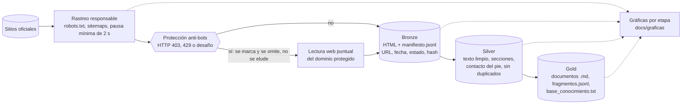

# Flujo de datos Medallion

Del sitio oficial a la base de conocimiento, con una gráfica por etapa (`docs/graficas/`).

Reglas: se respeta `robots.txt` y `Crawl-delay`, el User-Agent es identificable y los correos no corporativos se
anonimizan en Silver (Ley 1581 de 2012).
