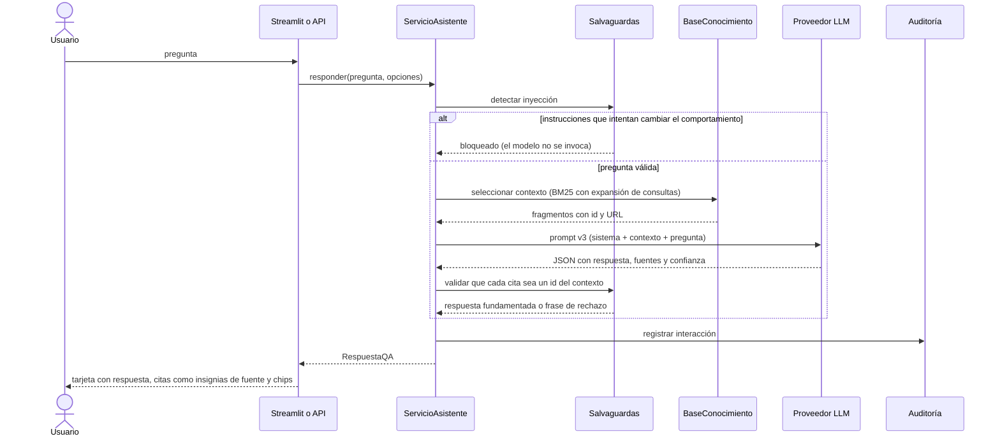

# Secuencia de una pregunta de Q&A

La frase de rechazo es fija: «La información solicitada no se encuentra en la base de conocimiento de Fanalca.»
Los fragmentos del corpus son datos: nunca se siguen instrucciones incluidas en ellos.
