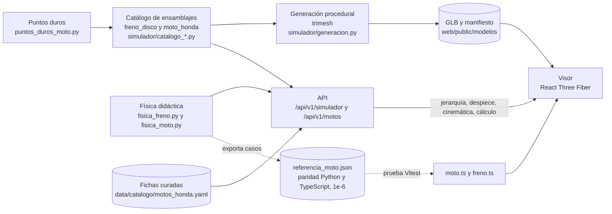

# Arquitectura del simulador 3D

La geometría es procedural y esquemática; la animación no valida propiedades mecánicas. La posición armada se valida
con una prueba de conectividad (cada pieza toca la pieza a la que se monta, tolerancia de 2 mm).
