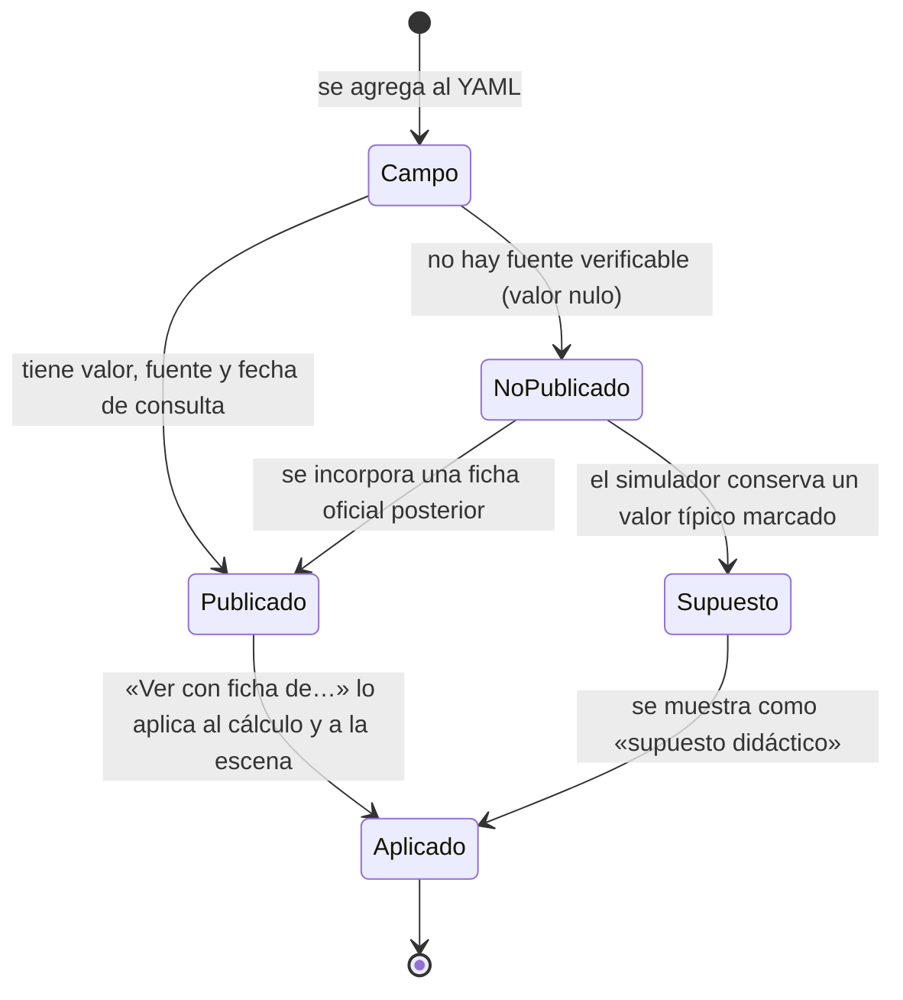
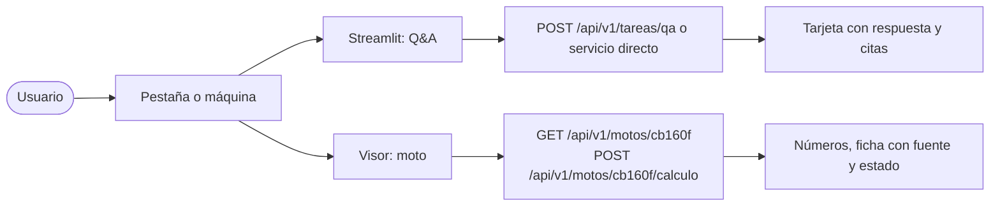

# Ciclo de vida de un dato de la ficha técnica

Reglas: un valor sin fuente y fecha, o un `no_publicado` con valor, invalida el catálogo
(`services.motos.validar_catalogo`). Nada se estima en silencio; la interfaz muestra «No publicado» o
«supuesto didáctico» según corresponda.

## Flujo funcional del usuario

