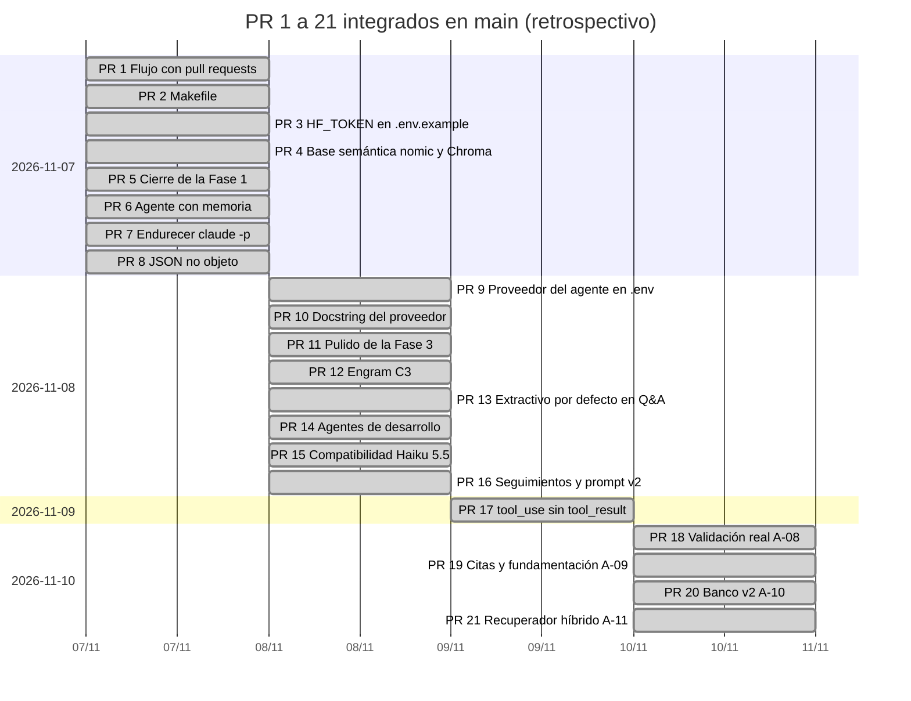
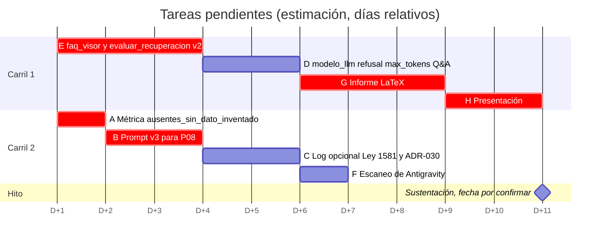

# Cronograma: ruta crítica (CPM) y diagrama de Gantt

Dos partes con naturaleza distinta:
- **Realizado (retrospectivo):** fechas de los PR #1 a #21 tomadas de `git log` en `main`.
- **Planificado (estimación):** tareas pendientes del [tablero](kanban.md), con duraciones estimadas en días de
  trabajo y fechas relativas. La fecha de la sustentación está **por confirmar**.

## Convención de fechas relativas

- **D+1** es el primer día de trabajo después del merge de este PR (`metodologias`); D+N es el día N de trabajo.
- Las duraciones son una **estimación** en días de trabajo de una persona, derivada de los puntos del tablero
  (aproximadamente 3 puntos ≈ 1 día, 5 ≈ 2 días y 8 ≈ 3 días; el log, con más archivos, se estima en 2 días).
- **Taller 1** queda fuera de la ruta crítica: su alcance está por confirmar.

## CPM, Critical Path Method (estimación)

| Id | Tarea | Duración (días, estimación) | Depende de |
|---|---|---|---|
| A | Métrica `ausentes_sin_dato_inventado` | 1 | — |
| B | Prompt v3 del agente para P08 (sin red y luego ejecución real) | 2 | A (la ejecución real de v3 se califica también con la métrica nueva) |
| C | Log de diagnóstico opcional (Ley 1581) + ADR-030 + `generar_matriz.py` | 2 | — |
| D | `modelo_llm` + `refusal` + `max_tokens` del Q&A | 2 | — |
| E | `faq_visor` y `evaluar_recuperacion` al banco v2 (repite E-06) | 3 | — |
| F | Escaneo de Antigravity con SkillSpector | 1 | — |
| G | Informe LaTeX | 3 | B, C, D y E (fijan las cifras y el estado final) |
| H | Presentación | 2 | G |
| M | Hito: sustentación (fecha por confirmar) | 0 | H y F |

Cálculo hacia adelante y hacia atrás, en días desde el inicio del plan (inicio temprano ES y fin temprano EF;
inicio tardío LS y fin tardío LF; la tarea ocupa los días D+(ES+1) a D+EF):

| Id | ES | EF | LS | LF | Holgura | ¿Crítica? |
|---|---|---|---|---|---|---|
| A | 0 | 1 | 0 | 1 | 0 | Sí |
| B | 1 | 3 | 1 | 3 | 0 | Sí |
| C | 0 | 2 | 1 | 3 | 1 | No |
| D | 0 | 2 | 1 | 3 | 1 | No |
| E | 0 | 3 | 0 | 3 | 0 | Sí |
| F | 0 | 1 | 7 | 8 | 7 | No |
| G | 3 | 6 | 3 | 6 | 0 | Sí |
| H | 6 | 8 | 6 | 8 | 0 | Sí |
| M | 8 | 8 | 8 | 8 | 0 | Sí |

**Rutas críticas (estimación): A → B → G → H → M y E → G → H → M**, ambas de 8 días. Un retraso en la métrica, en el
prompt v3, en `faq_visor` v2, en el informe o en la presentación retrasa la sustentación. C y D tienen 1 día de holgura;
F tiene 7.

**Efecto del límite WIP de 2 (estimación).** El CPM supone recursos ilimitados. Con un máximo de 2 tareas en curso, el
trabajo previo al informe (A + B + C + D + E = 10 días) necesita al menos 5 días, y el plan nivelado termina la
presentación en **D+10**, no en D+8:

| Carril | D+1 | D+2 | D+3 | D+4 | D+5 | D+6 | D+7 | D+8 | D+9 | D+10 |
|---|---|---|---|---|---|---|---|---|---|---|
| 1 | E | E | E | D | D | G | G | G | H | H |
| 2 | A | B | B | C | C | F | | | | |

Con este plan, la sustentación debe caer en **D+11 o después** (fecha por confirmar).

## Diagrama de Gantt

### Realizado (retrospectivo)

Cada barra marca el día del squash merge en `main` (fecha de `git log`); no representa la duración real del trabajo,
que el historial de `main` no registra. Los 42 commits anteriores al PR #1 se integraron sin PR (ADR-021) y no se
incluyen.

### Planificado (estimación)

Plan nivelado con WIP 2. Mermaid exige fechas absolutas: el origen técnico `1970-01-01` representa **D+1** y el eje
muestra «D+N». No son fechas reales.

Taller 1 no aparece en el diagrama: su alcance está por confirmar y no se le asigna duración. Las barras marcadas como críticas siguen las rutas críticas del CPM. En el plan nivelado, D y C tampoco tienen
holgura: cualquier retraso en ellas retrasa el informe.
